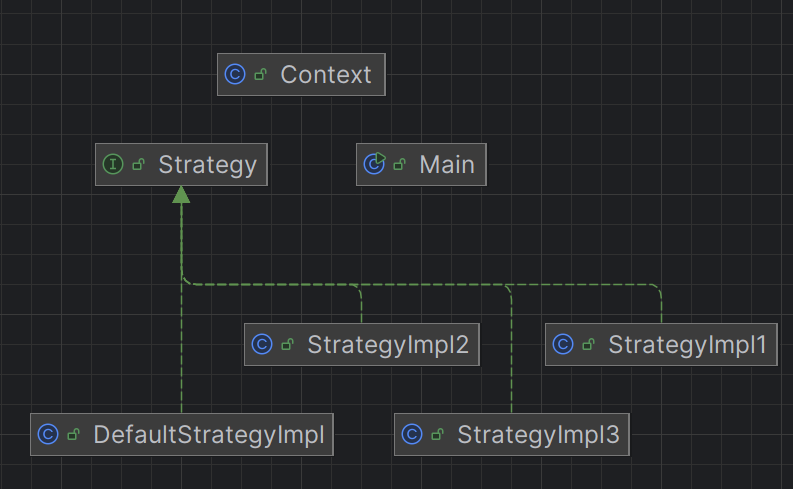
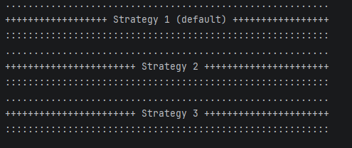
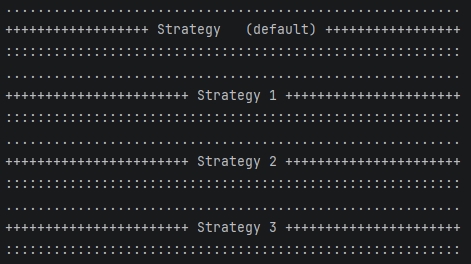
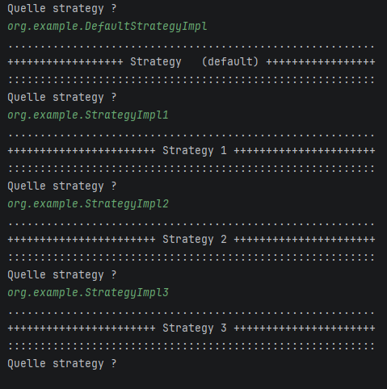
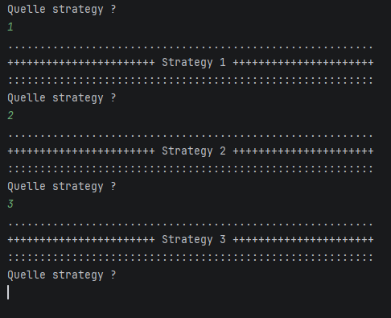
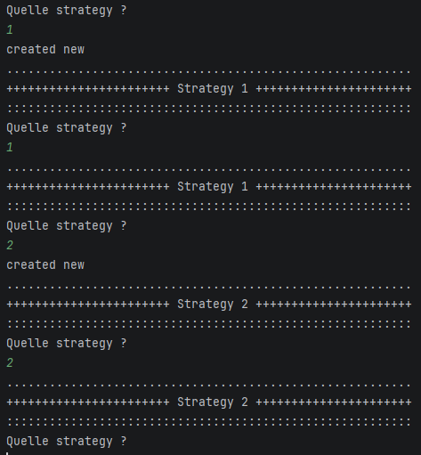

# Activité Pratique N°1 - Pattern Strategy

Nom et Prenom : Elcadi Hamza  
Filiere : GLSID-3

---

## Diagramme du pattern Strategy

On a commencé par créer les classes nécessaires pour implémenter le pattern Strategy. Le diagramme montre la relation entre le `Context`, l’interface `Strategy` et les stratégies concrètes.



---

## Implémentation statique du code

Avant d’aller vers la version dynamique, on a d’abord testé une implémentation statique en changeant directement la stratégie du contexte. Les lignes commentées dans le code montrent cette étape initiale.

```java
// context.effectuerOperation();
//
// context.setStrategy(new StrategyImpl1());
// context.effectuerOperation();
//
// context.setStrategy(new StrategyImpl2());
// context.effectuerOperation();
//
// context.setStrategy(new StrategyImpl3());
// context.effectuerOperation();
```



---

## Création de la stratégie par défaut

Ensuite, on a créé une stratégie par défaut pour initialiser le contexte avant que l’utilisateur choisisse une stratégie.

```java
public class DefaultStrategyImpl implements Strategy {
    @Override
    public void operationStrategy() {
        System.out.println(".........................................................");
        System.out.println("++++++++++++++++++ Strategy   (default) +++++++++++++++++");
        System.out.println(":::::::::::::::::::::::::::::::::::::::::::::::::::::::::");
    }
}
```



---

## Saisie du nom complet de la stratégie

Dans un premier temps, l’utilisateur devait écrire le nom complet de la classe, par exemple :

```text
org.example.StrategyImpl1
```

Le programme chargeait ensuite cette classe dynamiquement.



---

## Saisie simplifiée avec 1, 2 ou 3

Ensuite, on a simplifié l’entrée en demandant uniquement `1`, `2` ou `3`. Le code construit automatiquement le nom complet de la classe.

```java
strategy = (Strategy) Class.forName("org.example.StrategyImpl" + str).getConstructor().newInstance();
```



---

## Utilisation d’un Map pour éviter la redondance

Enfin, on a ajouté un `Map` pour ne pas recréer plusieurs fois la même stratégie.

```java
Map<String, Strategy> StrategyMap = new HashMap<>();
Strategy strategy;

while (true) {
    System.out.println("Quelle strategy ?");
    String str = sc.next();
    strategy = StrategyMap.get(str);

    if (strategy == null) {
        strategy = (Strategy) Class.forName("org.example.StrategyImpl" + str)
                .getConstructor()
                .newInstance();
        StrategyMap.put(str, strategy);
        System.out.println("New objet");
    }

    context.setStrategy(strategy);
    context.effectuerOperation();
}
```

On vérifie donc si la stratégie existe déjà dans la map ; sinon, on la crée puis on la stocke.



---

## Conclusion

Ce projet montre bien le pattern Strategy : le même `Context` peut exécuter plusieurs comportements différents sans changer sa logique. La stratégie est choisie dynamiquement, ce qui rend le code plus flexible et plus maintenable.
