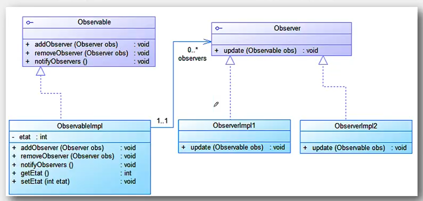
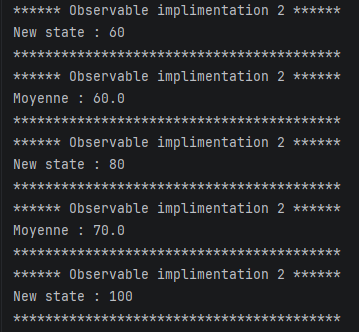
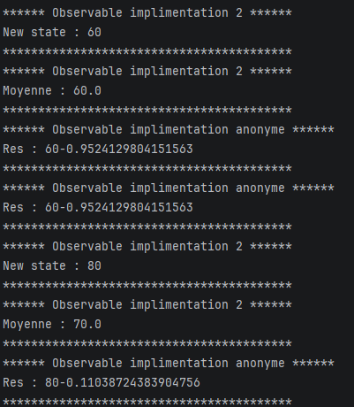

# Activité Pratique N°2 - Pattern Observer

Nom et prénom : Elcadi Hamza  
Filière : GLSID-3  
Référence : https://www.youtube.com/watch?v=1J0szjiMuJQ

---

## Diagramme du pattern Observer

On a commencé par créer les classes nécessaires pour implémenter le pattern Observer.



---

## Implémentation du diagramme de classes
# La méthode push
On crée les interfaces `Observer` et `Observable`.
```java
public interface Observer {
    void update(int state); // cas du push
}
public interface Observable {
    void subscribe(Observer o);
    void unsubscribe(Observer o);
    void notifyObservers();
}
```
Puis l'implémentation de l'interface `Observable` :
```java
public class ObservableImpl implements Observable{
    private List<Observer> observers = new ArrayList<>();
    private int state;
    @Override
    public void subscribe(Observer o) {
        observers.add(o);
    }

    @Override
    public void unsubscribe(Observer o) {
        observers.remove(o);
    }

    @Override
    public void notifyObservers() {
        for(Observer o : observers) {
            o.update(state);
        }
    }
    public void setState(int state) {
        this.state = state;
        notifyObservers();
    }
    public int getState() {
        return state;
    }
}
```
Puis les implémentations de l'interface `Observer` :
```java
public class ObserverImpl1 implements Observer{

    @Override
    public void update(int state) {
        System.out.println("****** Observable implimentation 2 ******");
        System.out.println("New state : " + state);
        System.out.println("*****************************************");

    }
}
public class ObserverImpl2 implements Observer{
    private List<Integer> history = new ArrayList<>();
    @Override
    public void update(int state) {
        history.add(state);
        double sum = 0;
        for (int i = 0 ; i < history.size() ; i++) {
            sum += history.get(i);
        }
        System.out.println("****** Observable implimentation 2 ******");
        System.out.println("Moyenne : " + sum/history.size());
        System.out.println("*****************************************");
    }
}
```
On le teste dans le `main` :
```java
public class Main {
    public static void main(String[] args) {
        ObservableImpl observable = new ObservableImpl();
        Observer o1 = new ObserverImpl1();
        Observer o2 = new ObserverImpl2();
        observable.subscribe(o1);
        observable.subscribe(o2);

        observable.setState(60);
        observable.setState(80);
        observable.unsubscribe(o2);
        observable.setState(100);

    }
}
```
 \
On peut créer un observateur anonyme :
```java
observable.subscribe(new Observer() {
            @Override
            public void update(int state) {
                System.out.println("****** Observable implimentation anonyme ******");
                System.out.println("Res : " + state + Math.cos(state));
                System.out.println("*****************************************");
            }
        });
```
On peut aussi utiliser une expression lambda pour faire cela. \
Pour cela, on ajoute d'abord l'annotation `@FunctionalInterface` à l'interface :
```java
@FunctionalInterface // interface fonctionnelle
// Une interface avec une seule méthode s'appelle une interface fonctionnelle.
public interface Observer {
    void update(int state); // cas du push
}
```
Puis :
```java
observable.subscribe((state) -> {
        System.out.println("****** Observable implimentation anonyme ******");
        System.out.println("Res : " + state + Math.cos(state));
        System.out.println("*****************************************");
});
```
La classe anonyme et la lambda sont équivalentes.

# La méthode pull
On modifie l'interface `Observer` :
```java
@FunctionalInterface
public interface Observer {
    void update(Observerable o);
}
```
Puis on modifie la méthode `update` dans la classe `ObserverImpl1` :
```java
public class ObserverImpl1 implements Observer{

    @Override
    public void update(Observable observable) {
        if (observable instanceof ObservableImpl obs) {
            System.out.println("****** Observable implimentation 2 ******");
            System.out.println("New state : " + obs.getState());
            System.out.println("*****************************************");
        }
    }
}
```
On met aussi à jour toutes les classes qui implémentent `Observable` :
```java
public class ObservableImpl implements Observable{
    private List<Observer> observers = new ArrayList<>();
    private int state;
    @Override
    public void subscribe(Observer o) {
        observers.add(o);
    }

    @Override
    public void unsubscribe(Observer o) {
        observers.remove(o);
    }

    @Override
    public void notifyObservers() {
        for(Observer o : observers) {
            o.update(this);
        }
    }
    public void setState(int state) {
        this.state = state;
        notifyObservers();
    }
    public int getState() {
        return state;
    }

}
```
```java
public class Main {
    public static void main(String[] args) {
        ObservableImpl observable = new ObservableImpl();
        Observer o1 = new ObserverImpl1();
        Observer o2 = new ObserverImpl2();
        observable.subscribe(o1);
        observable.subscribe(o2);

        // observateur anonyme
        observable.subscribe(new Observer() {
            @Override
            public void update(Observable o) {
                if (o instanceof ObservableImpl obs) {
                    System.out.println("****** Observable implimentation anonyme ******");
                    System.out.println("Res : " + obs.getState() + Math.cos(obs.getState()));
                    System.out.println("*****************************************");

                }
            }
        });

        observable.subscribe((o) -> {
            if (o instanceof ObservableImpl obs) {
                System.out.println("****** Observable implimentation anonyme ******");
                System.out.println("Res : " + obs.getState() + Math.cos(obs.getState()));
                System.out.println("*****************************************");
            }
        });
        observable.setState(60);
        observable.setState(80);
        observable.unsubscribe(o2);
        observable.setState(100);

    }
}
```
 \