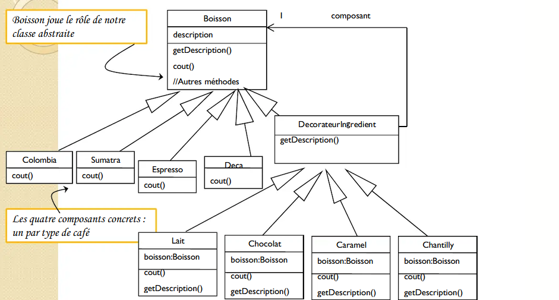
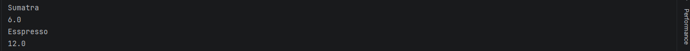
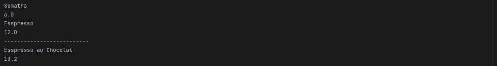
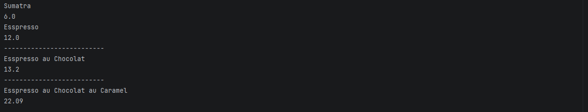
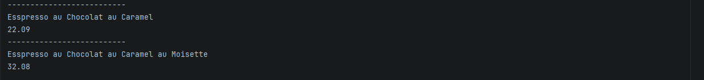
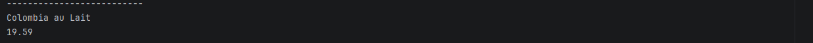

# Activité Pratique N°2 - Pattern Decorator

Nom et prénom : Elcadi Hamza  
Filière : GLSID-3  
Référence : https://www.youtube.com/watch?v=FWFW_40nNmY

---

## 1 - Diagramme du pattern Decorator

On a commencé par créer les classes nécessaires pour implémenter le pattern Decorator.



---

## Implémentation du diagramme de classes
On crée la classe abstraite `Boisson`.
```java
public abstract class Boisson {
    protected String description;
    public String getDescription() {
        return description;
    }
    public abstract double cout();
}
```
Puis on hérite de la classe abstraite avec `Sumatra`, `Deca` et `Espresso` :
```java
public class Sumatra extends Boisson {

    public Sumatra() {
        description = "Sumatra";
    }
    @Override
    public double cout() {
        return 6;
    }
}
```
```java
public class Deca extends Boisson {

    public Deca() {
        description = "Deca";
    }
    @Override
    public double cout() {
        return 8;
    }
}
```
```java
public class Espresso extends Boisson {

    public Espresso() {
        description = "Esspresso";
    }
    @Override
    public double cout() {
        return 12;
    }
}

```
Puis les implémentations de l'interface `Observer` :
```java
public class ObserverImpl1 implements Observer{

    @Override
    public void update(int state) {
        System.out.println("****** Observable implimentation 2 ******");
        System.out.println("New state : " + state);
        System.out.println("*****************************************");

    }
}
public class ObserverImpl2 implements Observer{
    private List<Integer> history = new ArrayList<>();
    @Override
    public void update(int state) {
        history.add(state);
        double sum = 0;
        for (int i = 0 ; i < history.size() ; i++) {
            sum += history.get(i);
        }
        System.out.println("****** Observable implimentation 2 ******");
        System.out.println("Moyenne : " + sum/history.size());
        System.out.println("*****************************************");
    }
}
```
On le teste dans la classe `Test` :
```java
public class Test {
    public static void main (String[] args) {
        Boisson boisson;
        boisson = new Sumatra();
        System.out.println(boisson.getDescription());
        System.out.println(boisson.cout());
        boisson = new Espresso();
        System.out.println(boisson.getDescription());
        System.out.println(boisson.cout());

    }
}
```
 \

Maintenant, on ajoute la possibilité d'ajouter des ingrédients. \
On crée une classe abstraite `Decorateur` :
```java
public abstract class Decorateur extends Boisson {
    Boisson boisson;

    public Decorateur(Boisson boisson) {
        this.boisson = boisson;
    }
}
```
Puis on crée les décorateurs concrets :
- `Chocolat`
```java
public class Chocolat extends Decorateur{

    public Chocolat(Boisson boisson) {
        super(boisson);
    }

    @Override
    public String getDescription() {
        return boisson.getDescription() + " au Chocolat";
    }

    @Override
    public double cout() {
        return 1.2 + boisson.cout();
    }
}
```
On le teste :
```java
public class Test {
    public static void main (String[] args) {
        Boisson boisson;
        boisson = new Sumatra();
        System.out.println(boisson.getDescription());
        System.out.println(boisson.cout());
        boisson = new Espresso();
        System.out.println(boisson.getDescription());
        System.out.println(boisson.cout());
        System.out.println("--------------------------");
        boisson = new Chocolat(boisson);
        System.out.println(boisson.getDescription());
        System.out.println(boisson.cout());

    }
}
```
 \

- `Caramel`
```java
public class Caramel extends Decorateur{

    public Caramel(Boisson boisson) {
        super(boisson);
    }

    @Override
    public String getDescription() {
        return boisson.getDescription() + " au Caramel";
    }

    @Override
    public double cout() {
        return 8.89 + boisson.cout();
    }
}
```
On le teste :
```java
// en ajoutant ce code
System.out.println("--------------------------");
boisson = new Caramel(boisson);
System.out.println(boisson.getDescription());
System.out.println(boisson.cout());
```
 \

- `Moisette`
```java
public class Moisette extends Decorateur{

    public Moisette(Boisson boisson) {
        super(boisson);
    }

    @Override
    public String getDescription() {
        return boisson.getDescription() + " au Moisette";
    }

    @Override
    public double cout() {
        return 9.99 + boisson.cout();
    }
}
```
On le teste avec :
```java
boisson = new Moisette(boisson);
System.out.println(boisson.getDescription());
System.out.println(boisson.cout());
```
 \
On ajoute ensuite les autres décorateurs et boissons, puis on teste :
```java
System.out.println("--------------------------");
boisson = new Colombia();
boisson = new Lait(boisson);
System.out.println(boisson.getDescription());
        System.out.println(boisson.cout());
```
 \