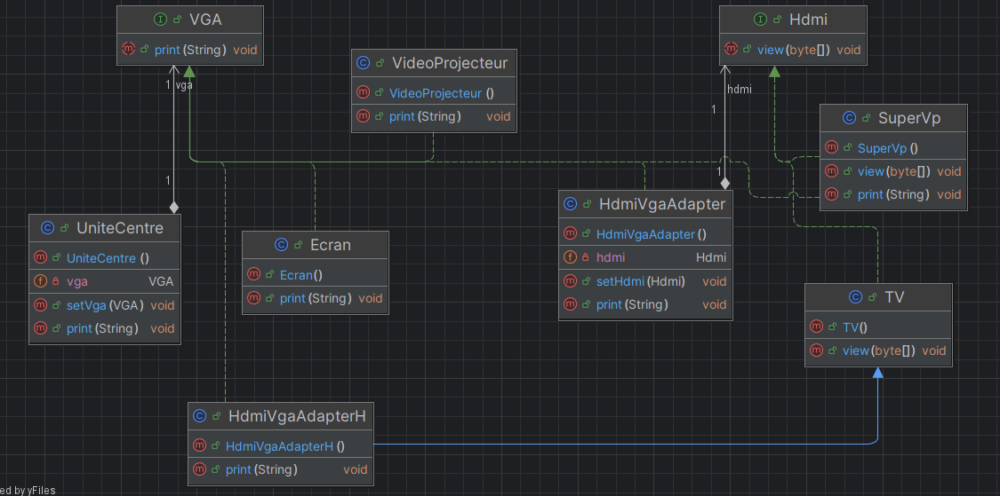
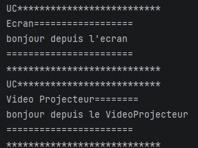
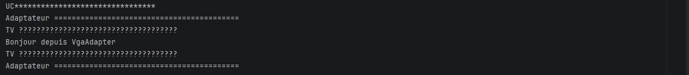
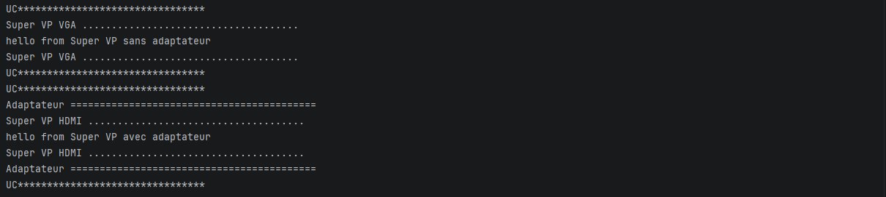
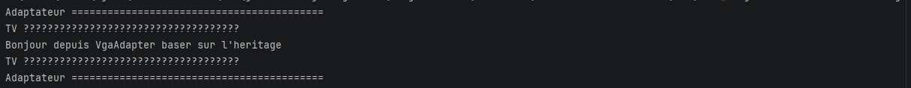

# Activité Pratique N°3 - Pattern Adapter

Nom et prénom : Elcadi Hamza  
Filière : GLSID-3  
Référence : https://www.youtube.com/watch?v=C42naMy7Wfo

---

## 1 - Diagramme du pattern Adapter

On a commencé par créer les classes nécessaires pour implémenter le pattern Adapter.



---

## Implémentation du diagramme de classes
On crée la classe `UniteCentre` :
```java
public class UniteCentre {
    private VGA vga;
    public void print(String message){
        System.out.println("UC********************************");
        vga.print(message);
        System.out.println("UC********************************");
    }

    public void setVga(VGA vga) {
        this.vga = vga;
    }
}
```
Puis l'interface `VGA` :
```java
public interface computer.VGA {
    void print(String message);
}
```
Puis les classes qui implémentent l'interface `VGA` :
- `Ecran`
```java
public class Ecran implements VGA{
    @Override
    public void print(String message) {
        System.out.println("Ecran ==============================");
        System.out.println(message);
        System.out.println("Ecran ==============================");
    }
}
```
- `VideoProjecteur`
```java
public class VideoProjecteur implements VGA{
    @Override
    public void print(String message) {
        System.out.println("Video Projecteur ==========================");
        System.out.println(message);
        System.out.println("Video Projecteur ==========================");
    }
}
```
Puis on crée la classe `Test` :
```java
public class Test {
    public static void main(String[] args) {
        UniteCentre uniteCentre = new UniteCentre();
        uniteCentre.setVga(new Ecran());
        uniteCentre.print("bonjour depuis l'ecran");
        uniteCentre.setVga(new VideoProjecteur());
        uniteCentre.print("bonjour depuis le VideoProjecteur");
    }
}
```
 \

On crée l'interface `Hdmi` :
```java
public interface Hdmi {
    void view(byte[] data);
}
```
Puis une classe `TV` qui implémente l'interface `Hdmi` :
```java
public class TV implements Hdmi{
    @Override
    public void view(byte[] data) {
        System.out.println("TV ????????????????????????????????????")
        String message = new String(data);
        System.out.println(message);
        System.out.println("TV ????????????????????????????????????")
    }
}
```
Le problème ici est qu'on ne peut pas faire ceci :
```java
uniteCentre.setVga(new TV());
```
On ne peut pas brancher la `TV` sur `UniteCentre`, parce que cette dernière n'accepte que du `VGA`. \
Dans ce genre de situation, on utilise un adaptateur. \
On crée la classe `HdmiVgaAdapter` :
```java
public class HdmiVgaAdapter implements VGA {
    //utilisant la composition
    private Hdmi hdmi;

    @Override
    public void print(String message) {
        System.out.println("Adaptateur ==========================================");
        byte[] data = message.getBytes();
        hdmi.view(data);
        System.out.println("Adaptateur ==========================================");
    }

    public void setHdmi(Hdmi hdmi) {
        this.hdmi = hdmi;
    }
}
```
Il traduit le VGA en HDMI en utilisant la composition. \
On le teste :
```java
HdmiVgaAdapter hdmiVgaAdapter = new HdmiVgaAdapter();
hdmiVgaAdapter.setHdmi(new TV());
uniteCentre.setVga(hdmiVgaAdapter);
hdmiVgaAdapter.print("Bonjour depuis VgaAdapter");
```
 \

Maintenant, passons à l'héritage. \
On crée la classe `SuperVp` qui implémente les deux interfaces `VGA` et `Hdmi` :
```java
public class SuperVp implements VGA, Hdmi{
    @Override
    public void view(byte[] data) {
        String message = new String(data);
        System.out.println("Super VP HDMI .....................................");
        System.out.println(message);
        System.out.println("Super VP HDMI .....................................");

    }

    @Override
    public void print(String message) {
        System.out.println("Super VP VGA .....................................");
        System.out.println(message);
        System.out.println("Super VP VGA .....................................");

    }
}
```
On le teste :
```java
// la classe SuperVp peut s'utiliser sans adaptateur ou
// avec adaptateur, car elle implémente les deux interfaces en même temps.
uniteCentre.setVga(new SuperVp());
uniteCentre.print("hello from Super VP sans adaptateur");

HdmiVgaAdapter hdmiVgaAdapter_ = new HdmiVgaAdapter();
hdmiVgaAdapter_.setHdmi(new SuperVp());
uniteCentre.setVga(hdmiVgaAdapter_);
uniteCentre.print("hello from Super VP avec adaptateur");
``` 
 \
Maintenant, on implémente l'adaptateur en se basant sur l'héritage. \
C'est-à-dire qu'à la place de ceci :
```java
public class HdmiVgaAdapter implements VGA {
    //utilisant la composition
    private Hdmi hdmi;

    @Override
    public void print(String message) {
        System.out.println("Adaptateur ==========================================");
        byte[] data = message.getBytes();
        hdmi.view(data);
        System.out.println("Adaptateur ==========================================");
    }

    public void setHdmi(Hdmi hdmi) {
        this.hdmi = hdmi;
    }
}
```
on utilise ceci :
```java
//utilisant l'héritage
public class HdmiVgaAdapterH extends TV implements VGA {

    @Override
    public void print(String message) {
        System.out.println("Adaptateur ==========================================");
        byte[] data = message.getBytes();
        super.view(data);
        System.out.println("Adaptateur ==========================================");
    }
}
}
```
Et on teste :
```java
// Adaptateur basé sur l'héritage
HdmiVgaAdapterH hdmiVgaAdapterH = new HdmiVgaAdapterH();
uniteCentre.setVga(hdmiVgaAdapterH);
hdmiVgaAdapterH.print("Bonjour depuis VgaAdapter baser sur l'heritage");
```
 \