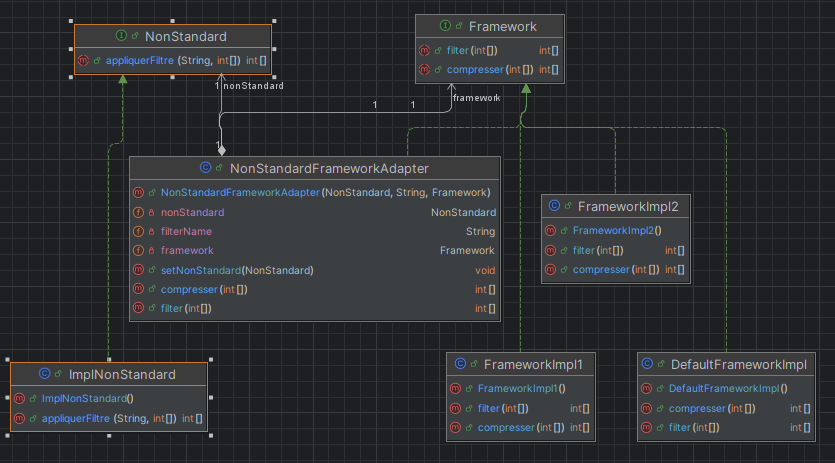
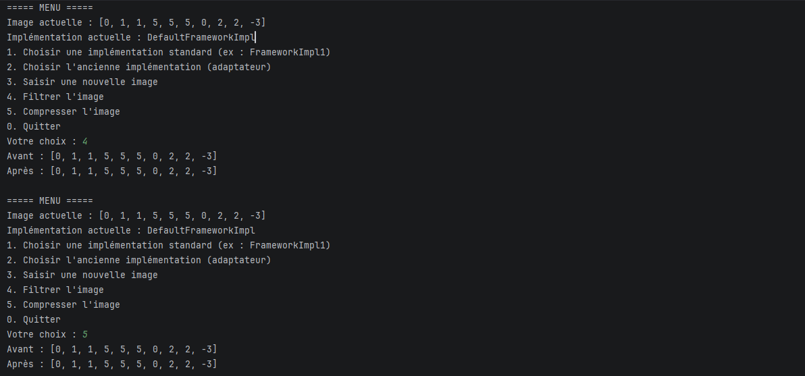
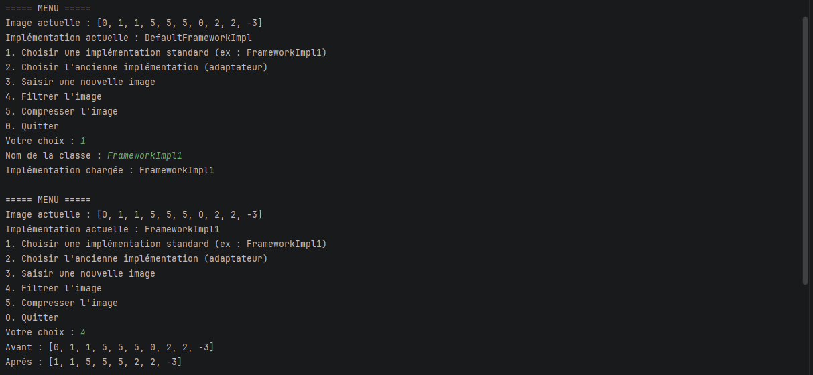
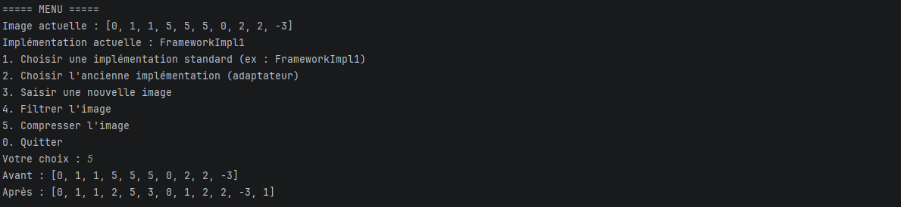
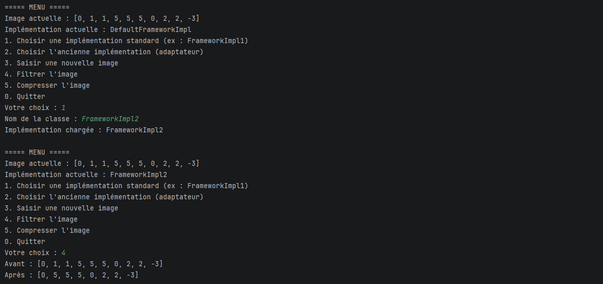
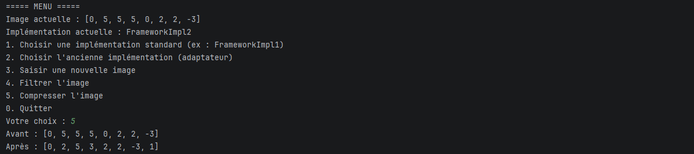
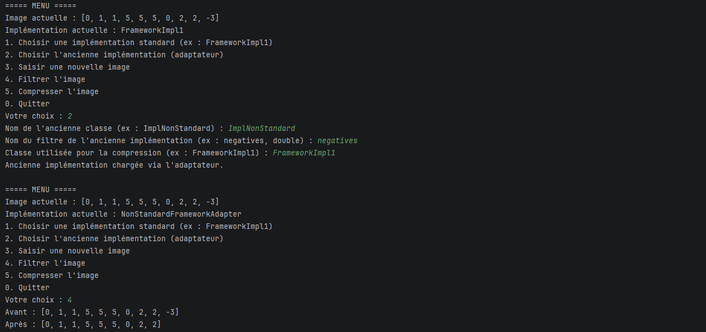
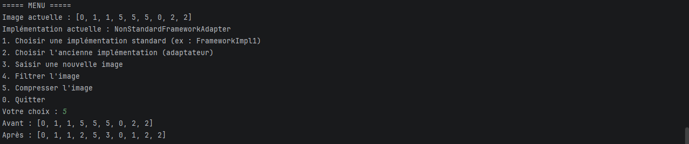

# Exercice 2 - TD 1 : Design patterns
Nom et Prenom : Elcadi Hamza \
Fillier : GLSID-3

---
## Correction :
1 . Etablir un diagramme de classes de ce Framework en appliquant les design patterns
appropriés. \


Pour répondre aux critères de l'énoncé, on utilise deux design patterns :
- Strategy : Framework fermé à la modification et ouvert à l'extension, et changement dynamique de l'implémentation à l'exécution
- Adapter : Réutiliser l'ancienne implémentation ImplNonStandard dont la signature est différente
---

2 . Ecrire une implémentation Java de ce Framework.

On commence par la classe `Image` :
```java
package exercice2;

import java.util.Arrays;

public class Image {
    private int[] data;

    public Image(int[] data) {
        this.data = data;
    }

    public int[] getData() {
        return data;
    }

    public void setData(int[] data) {
        this.data = data;
    }

    @Override
    public String toString() {
        return Arrays.toString(data);
    }
}
```
Puis l'interface `Framework` (c'est la **stratégie**) :
```java
package exercice2.framework;

public interface Framework {
    public int[] filter (int [] data);
    public int[] compresser (int [] data);
}
```
Puis les classes qui implémentent l'interface `Framework` :
- `DefaultFrameworkImpl` : l'implémentation par défaut, elle ne filtre rien et ne compresse rien.
```java
package exercice2.framework;

public class DefaultFrameworkImpl implements Framework {
    @Override
    public int[] filter(int[] data) {
        return data.clone();
    }

    @Override
    public int[] compresser(int[] data) {
        return data.clone();
    }
}
```
- `FrameworkImpl1` : filtre tous les 0 et compresse avec l'algorithme RLE.
```java
package exercice2.framework;

import java.util.ArrayList;
import java.util.Arrays;
import java.util.List;

public class FrameworkImpl1 implements Framework {

    // filtre tous les 0
    @Override
    public int[] filter(int[] data) {
        return Arrays.stream(data).filter(v -> v != 0).toArray();
    }

    // compress {5,5,5,2,2} -> {5,3,2,2}
    @Override
    public int[] compresser(int[] data) {
        List<Integer> out = new ArrayList<>();
        int i = 0;
        while (i < data.length) {
            int value = data[i], count = 1;
            while (i + count < data.length && data[i + count] == value) count++;
            out.add(value);
            out.add(count);
            i += count;
        }
        return out.stream().mapToInt(Integer::intValue).toArray();
    }
}
```
- `FrameworkImpl2` : filtre tous les 1 et compresse avec un dictionnaire (chaque valeur avec son nombre d'occurrences).
```java
package exercice2.framework;

import java.util.Arrays;
import java.util.LinkedHashMap;
import java.util.Map;

public class FrameworkImpl2 implements Framework {

    // filtre tous les 1
    @Override
    public int[] filter(int[] data) {
        return Arrays.stream(data).filter(v -> v != 1).toArray();
    }

    // compress {5,2,5,2,5} -> {5,3,2,2}
    @Override
    public int[] compresser(int[] data) {
        Map<Integer, Integer> dict = new LinkedHashMap<>();
        for (int v : data) dict.merge(v, 1, Integer::sum);

        int[] out = new int[dict.size() * 2];
        int i = 0;
        for (Map.Entry<Integer, Integer> e : dict.entrySet()) {
            out[i++] = e.getKey();
            out[i++] = e.getValue();
        }
        return out;
    }
}
```

Maintenant, l'ancienne implémentation. On a l'interface `NonStandard` :
```java
package exercice2.NonStandard;

public interface NonStandard {
    int[] appliquerFiltre(String filterName, int[] data);
}
```
Et la classe `ImplNonStandard` qui l'implémente :
```java
package exercice2.NonStandard;

import java.util.Arrays;

public class ImplNonStandard implements NonStandard {
    @Override
    public int[] appliquerFiltre(String filterName, int[] data) {
        switch (filterName) {
            case "negatives":
                return Arrays.stream(data).filter(v -> v >= 0).toArray();
            case "double":
                return Arrays.stream(data).map(v -> v * 2).toArray();
            default:
                return data.clone();
        }
    }
}
```
Le problème ici est qu'on ne peut pas utiliser `ImplNonStandard` comme un `Framework`, car sa signature `appliquerFiltre(String, int[])` est différente de `filter(int[])`. \
De plus, elle ne sait pas compresser. \
Dans ce genre de situation, on utilise un adaptateur. \
On crée la classe `NonStandardFrameworkAdapter` :
```java
package exercice2.adapter;

import exercice2.NonStandard.NonStandard;
import exercice2.framework.Framework;

public class NonStandardFrameworkAdapter implements Framework {
    private NonStandard nonStandard;
    private String filterName;
    private Framework framework;

    public NonStandardFrameworkAdapter(NonStandard nonStandard, String filterName, Framework compressionDelegate) {
        this.nonStandard = nonStandard;
        this.filterName = filterName;
        this.framework = compressionDelegate;
    }

    @Override
    public int[] filter(int[] data) {
        return nonStandard.appliquerFiltre(filterName, data);
    }

    @Override
    public int[] compresser(int[] data) {
        return framework.compresser(data);
    }
    public void setNonStandard(NonStandard nonStandard) {
        this.nonStandard = nonStandard;
    }
}
```
Il traduit `filter` en `appliquerFiltre` en utilisant la composition. \
Pour la compression, l'ancienne implémentation ne la supporte pas, donc l'adaptateur la délègue à un autre `Framework` (`compressionDelegate`).

---

3 . Ecrire le code d’une application qui utilise ce Framework en permettant à l’utilisateur de saisir
le nom des classes d’implémentation à utiliser pour effectuer les traitements.

L'idée est d'utiliser la **réflexion** : l'utilisateur saisit le nom de la classe (par exemple `FrameworkImpl2`), et l'application la charge avec `Class.forName(...)`. \
Les préfixes de package (`exercice2.framework.` et `exercice2.NonStandard.`) sont ajoutés dans le code, donc l'utilisateur ne tape que le nom simple de la classe. \
Au démarrage, l'application utilise `DefaultFrameworkImpl`.

On crée la classe `Main` :
```java
package exercice2;

import exercice2.NonStandard.NonStandard;
import exercice2.adapter.NonStandardFrameworkAdapter;
import exercice2.framework.DefaultFrameworkImpl;
import exercice2.framework.Framework;

import java.util.Arrays;
import java.util.Scanner;

public class Main {

    private static final String FRAMEWORK_PACKAGE = "exercice2.framework.";
    private static final String LEGACY_PACKAGE = "exercice2.NonStandard.";

    // Cree un objet a partir du nom simple de la classe + le prefixe du package
    private static Object instantiate(String packagePrefix, String simpleName) throws Exception {
        Class<?> cls = Class.forName(packagePrefix + simpleName.trim());
        return cls.getDeclaredConstructor().newInstance();
    }

    private static Framework loadFramework(String simpleName) throws Exception {
        Object o = instantiate(FRAMEWORK_PACKAGE, simpleName);
        if (!(o instanceof Framework)) {
            throw new IllegalArgumentException(simpleName + " n'implémente pas Framework");
        }
        return (Framework) o;
    }

    private static int[] readData(String line) {
        return Arrays.stream(line.trim().split("\\s+"))
                .mapToInt(Integer::parseInt)
                .toArray();
    }

    public static void main(String[] args) {
        Scanner sc = new Scanner(System.in);
        // implementation par defaut au demarrage
        Framework framework = new DefaultFrameworkImpl();
        Image image = new Image(new int[]{0, 1, 1, 5, 5, 5, 0, 2, 2, -3});

        while (true) {
            System.out.println("\n===== MENU =====");
            System.out.println("Image actuelle : " + image);
            System.out.println("Implémentation actuelle : " + framework.getClass().getSimpleName());
            System.out.println("1. Choisir une implémentation standard (ex : FrameworkImpl1)");
            System.out.println("2. Choisir l'ancienne implémentation (adaptateur)");
            System.out.println("3. Saisir une nouvelle image");
            System.out.println("4. Filtrer l'image");
            System.out.println("5. Compresser l'image");
            System.out.println("0. Quitter");
            System.out.print("Votre choix : ");
            String choice = sc.nextLine().trim();

            try {
                switch (choice) {
                    case "1": {
                        System.out.print("Nom de la classe : ");
                        framework = loadFramework(sc.nextLine());
                        System.out.println("Implémentation chargée : " + framework.getClass().getSimpleName());
                        break;
                    }
                    case "2": {
                        System.out.print("Nom de l'ancienne classe (ex : ImplNonStandard) : ");
                        NonStandard legacy = (NonStandard) instantiate(LEGACY_PACKAGE, sc.nextLine());
                        System.out.print("Nom du filtre de l'ancienne implémentation (ex : negatives, double) : ");
                        String filterName = sc.nextLine().trim();
                        System.out.print("Classe utilisée pour la compression (ex : FrameworkImpl1) : ");
                        Framework compression = loadFramework(sc.nextLine());
                        framework = new NonStandardFrameworkAdapter(legacy, filterName, compression);
                        System.out.println("Ancienne implémentation chargée via l'adaptateur.");
                        break;
                    }
                    case "3": {
                        System.out.print("Valeurs séparées par des espaces : ");
                        image = new Image(readData(sc.nextLine()));
                        break;
                    }
                    case "4": {
                        System.out.println("Avant : " + image);
                        image.setData(framework.filter(image.getData()));
                        System.out.println("Après : " + image);
                        break;
                    }
                    case "5": {
                        System.out.println("Avant : " + image);
                        image.setData(framework.compresser(image.getData()));
                        System.out.println("Après : " + image);
                        break;
                    }
                    case "0":
                        System.out.println("Au revoir.");
                        return;
                    default:
                        System.out.println("Choix invalide.");
                }
            } catch (ClassNotFoundException e) {
                System.out.println("Classe introuvable : " + e.getMessage());
            } catch (ClassCastException e) {
                System.out.println("Cette classe n'est pas du type attendu.");
            } catch (NumberFormatException e) {
                System.out.println("Nombre invalide dans les données.");
            } catch (Exception e) {
                System.out.println("Erreur : " + e.getMessage());
            }
        }
    }
}
```

### Test 1 : implémentation par défaut
Au démarrage, `DefaultFrameworkImpl` ne modifie pas l'image. \


### Test 2 : FrameworkImpl1 (filtre les 0 + compression RLE) 
 \


### Test 3 : FrameworkImpl2 (filtre les 1 + compression par dictionnaire)
On change l'implémentation dynamiquement à l'exécution, sans modifier le code. \
 \


### Test 4 : ancienne implémentation avec l'adaptateur
On saisit `ImplNonStandard`, le filtre `negatives`, et `FrameworkImpl1` pour la compression. \
 \

