# Activité Pratique N°5 : Programmation orientée aspect (AOP)

**Nom et prénom :** Elcadi Hamza  
**Filière :** GLSID-3  
**Références :**
- https://www.youtube.com/watch?v=2tex4z9rwag
- https://www.youtube.com/watch?v=8dPXOKR3AN8
- https://www.youtube.com/watch?v=NLhjdiFq63I

---

# 1. Première référence : prise en main d'AspectJ

## 1.1 Configuration du projet

Nous commençons par ajouter le plugin AspectJ à l'IDE :

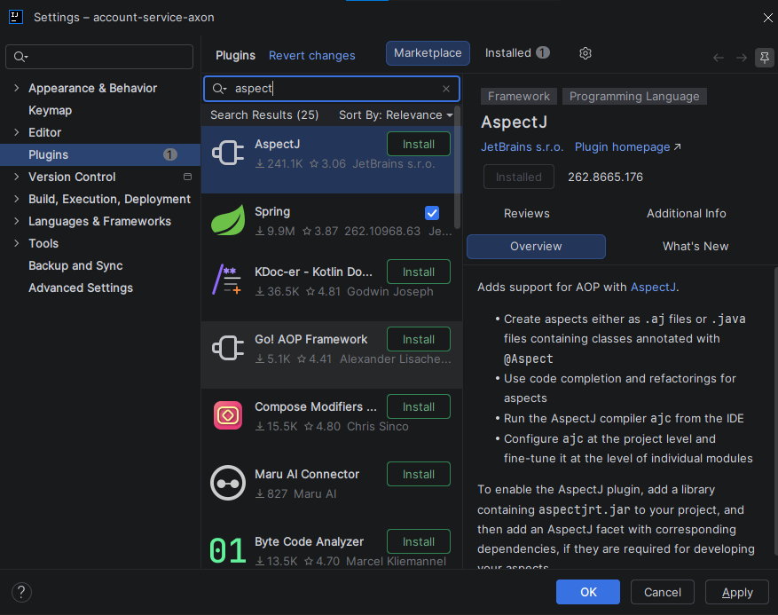

Ensuite, nous téléchargeons et installons AspectJ depuis la page officielle des versions : https://github.com/eclipse-aspectj/aspectj/releases/tag/V1_9_23

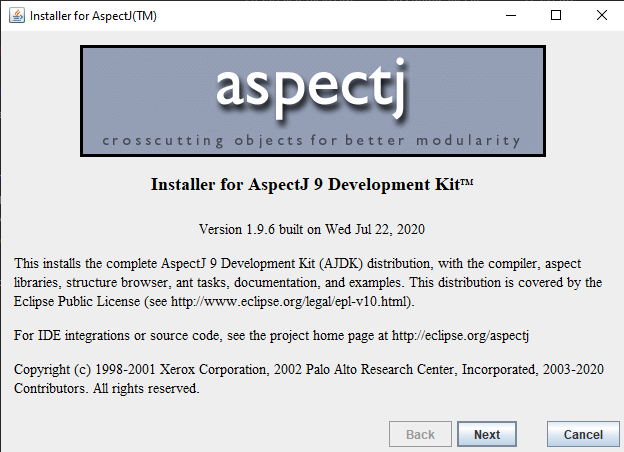

Nous créons ensuite le projet :

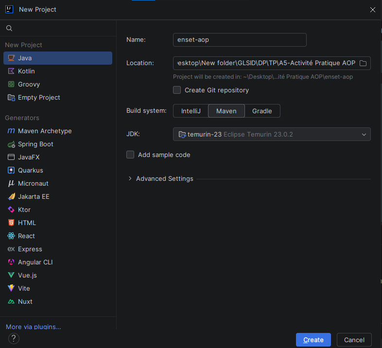

Puis nous ajoutons la bibliothèque AspectJ au projet :

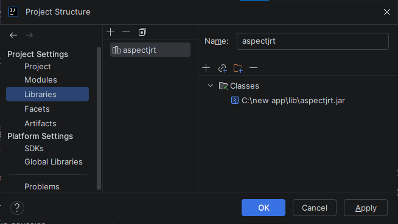

Enfin, nous ajoutons la facette AspectJ au projet :

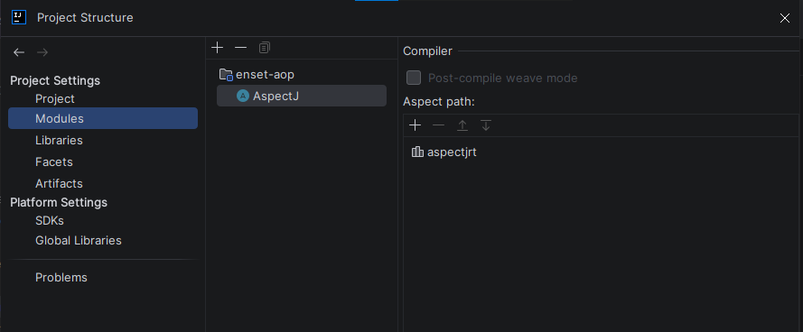

## 1.2 Création d'une fonctionnalité métier simple

Nous créons une classe `Application` avec une méthode `main` qui affiche un message :

```java
public class Application {
    public static void main(String[] args) {
        System.out.println("Message From Application");
    }
}
```

## 1.3 Création d'un aspect avec la syntaxe AspectJ

Nous créons un aspect qui s'exécute avant et après la méthode `main`. Le pointcut `pc1` désigne l'exécution de cette méthode, et les advices `before` et `after` y sont rattachés :

```java
public aspect FirstAspect {
    pointcut pc1(): execution(* test.Application.main(..));

    before(): pc1() {
        System.out.println("before main ---------------------");
    }

    after(): pc1() {
        System.out.println("after main ---------------------");
    }
}
```

Pour que l'aspect soit tissé (weaving) dans le code, il faut remplacer le compilateur Java par le compilateur AspectJ (`ajc`) dans les paramètres du projet :

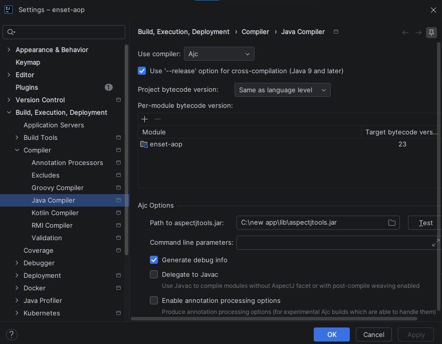

Résultat de l'exécution :

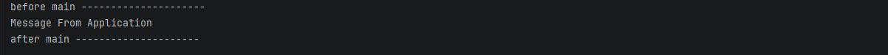

Nous testons ensuite l'advice `around`. Il entoure l'exécution de la méthode : l'appel à `proceed()` déclenche l'exécution de la méthode d'origine.

```java
void around(): pc1() {
    System.out.println("before ---------------------------");
    proceed();
    System.out.println("after ---------------------------");
}
```

Résultat de l'exécution :


## 1.4 Création d'un aspect avec la syntaxe des classes (annotations)

AspectJ permet aussi de définir un aspect comme une classe Java ordinaire, grâce aux annotations. Nous créons l'aspect `SecondAspect` :

```java
@Aspect
public class SecondAspect {
    @Pointcut("execution(* test.*.main(..))")
    public void pc1() {}

    @Before("pc1()")
    public void beforeMain() {
        System.out.println("before main ---------------------------");
    }

    @After("pc1()")
    public void afterMain() {
        System.out.println("after main ---------------------------");
    }
}
```

Résultat de l'exécution :

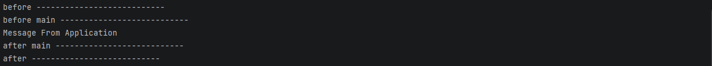

Nous testons ensuite l'advice `@Around`. Avec cette syntaxe, l'objet `ProceedingJoinPoint` permet de contrôler l'exécution de la méthode ciblée via `proceed()` :

```java
@Around("pc1()")
public void aroundMain(ProceedingJoinPoint proceedingJoinPoint) throws Throwable {
    System.out.println("before main ---------------------------");
    proceedingJoinPoint.proceed();
    System.out.println("after main ---------------------------");
}
```

Résultat de l'exécution :


---

# 2. Deuxième référence : application bancaire avec plusieurs aspects

## 2.1 Code métier

Nous créons les classes et l'interface suivantes.

**`metier.Compte`** : représente un compte bancaire (code et solde).

```java
public class Compte {
    private Long code;
    private double solde;

    public Compte(Long code, double solde) {
        this.code = code;
        this.solde = solde;
    }

    public Long getCode() {
        return code;
    }

    public void setCode(Long code) {
        this.code = code;
    }

    public double getSolde() {
        return solde;
    }

    public void setSolde(double solde) {
        this.solde = solde;
    }

    @Override
    public String toString() {
        return "Compte{" +
                "code=" + code +
                ", solde=" + solde +
                '}';
    }
}
```

**`metier.IMetier`** : définit les opérations disponibles.

```java
public interface IMetier {
    void addCompte(Compte cp);
    void verser(Long code, double mt);
    void retirer(Long code, double mt);
    Compte getCompte(Long code);
}
```

**`metier.MetierImpl`** : implémente ces opérations en stockant les comptes dans une `HashMap`.

```java
public class MetierImpl implements IMetier {
    private Map<Long, Compte> comptes = new HashMap<>();

    @Override
    public void addCompte(Compte cp) {
        comptes.put(cp.getCode(), cp);
    }

    @Override
    public void verser(Long code, double mt) {
        Compte cp = comptes.get(code);
        cp.setSolde(cp.getSolde() + mt);
    }

    @Override
    public void retirer(Long code, double mt) {
        Compte cp = comptes.get(code);
        cp.setSolde(cp.getSolde() - mt);
    }

    @Override
    public Compte getCompte(Long code) {
        return comptes.get(code);
    }
}
```

**`test.Application`** : application console qui permet de créer un compte, puis d'effectuer des versements (`v`), des retraits (`r`) ou de quitter (`q`).

```java
public class Application {
    public static void main(String[] args) {
        new Application().start();
    }

    private void start() {
        System.out.println("Starting Application .....");
        IMetier metier = new MetierImpl();
        Scanner clavier = new Scanner(System.in);
        System.out.print("Code:");
        Long code = clavier.nextLong();
        System.out.print("Solde:");
        double solde = clavier.nextDouble();
        metier.addCompte(new Compte(code, solde));
        while (true) {
            try {
                System.out.println("=========================================");
                System.out.println(metier.getCompte(code).toString());
                System.out.print("Type Opération:");
                String type = clavier.next();
                if (type.equals("q")) break;
                System.out.print("Montant:");
                double montant = clavier.nextDouble();
                if (type.toLowerCase().equals("v")) metier.verser(code, montant);
                else if (type.toLowerCase().equals("r")) metier.retirer(code, montant);
            } catch (Exception e) {
                System.out.println(e.getMessage());
            }
        }
    }
}
```

Test de l'application :

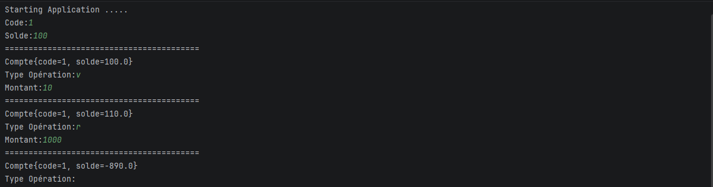

**Constat :** l'utilisateur peut retirer un montant supérieur au solde, ce qui donne un solde négatif. Nous allons corriger ce problème avec des aspects, sans modifier le code métier.

## 2.2 Code des aspects

### `aspects.LoggingAspect` : journalisation et mesure du temps d'exécution

Cet aspect affiche un message avant et après chaque méthode de `MetierImpl`, et mesure sa durée d'exécution :

```java
@Aspect
public class LoggingAspect {
    long t1, t2;

    @Pointcut("execution(* metier.MetierImpl.*(..))")
    public void pc1() {}

    @Before("pc1()")
    public void avant(JoinPoint joinPoint) {
        t1 = System.currentTimeMillis();
        System.out.println("Avant " + joinPoint.getSignature() + " --------------------------");
    }

    @After("pc1()")
    public void apres(JoinPoint joinPoint) {
        System.out.println("Après " + joinPoint.getSignature() + " --------------------------");
        t2 = System.currentTimeMillis();
        System.out.println("Durée d'exécution : " + (t2 - t1));
        System.out.println("-----------------------------------");
    }
}
```

Résultats :

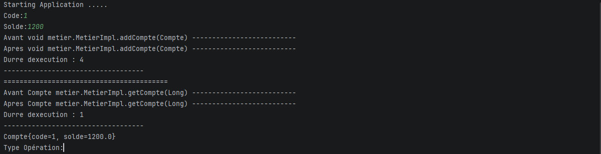
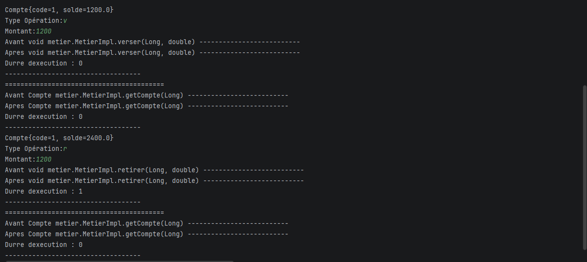

Nous remplaçons ensuite `System.out.println` par un framework de journalisation (`java.util.logging`), plus adapté à une application réelle :

```java
@Aspect
public class LoggingAspect {
    private Logger logger = Logger.getLogger(this.getClass().getName());
    long t1, t2;

    @Pointcut("execution(* metier.MetierImpl.*(..))")
    public void pc1() {}

    @Before("pc1()")
    public void avant(JoinPoint joinPoint) {
        t1 = System.currentTimeMillis();
        logger.info("Avant " + joinPoint.getSignature() + " --------------------------");
    }

    @After("pc1()")
    public void apres(JoinPoint joinPoint) {
        t2 = System.currentTimeMillis();
        logger.info("Après " + joinPoint.getSignature() + " --------------------------");
        logger.info("Durée d'exécution : " + (t2 - t1));
        logger.info("-----------------------------------");
    }
}
```

Résultat :

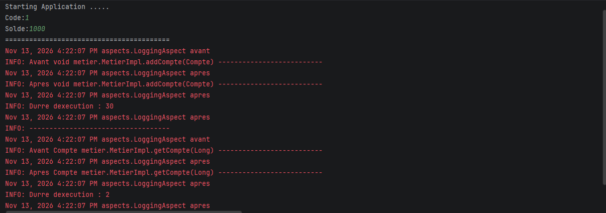

Ensuite, nous sauvegardons les logs dans un fichier XML grâce à un `FileHandler`. L'appel à `setUseParentHandlers(false)` désactive l'affichage dans la console :

```java
public LoggingAspect() throws IOException {
    logger.addHandler(new FileHandler("log.xml"));
    logger.setUseParentHandlers(false);
}
```

Résultat :

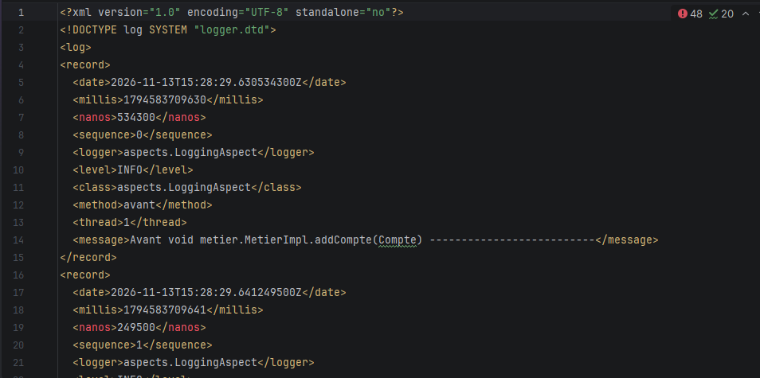

Nous pouvons aussi regrouper les deux advices (`@Before` et `@After`) en un seul advice `@Around`. Cette version est préférable : les temps `t1` et `t2` sont des variables locales (et non des attributs de la classe), ce qui évite les problèmes en cas d'exécution simultanée de plusieurs threads. Il suffit d'utiliser `ProceedingJoinPoint`, qui hérite de `JoinPoint` et donne donc aussi accès à la signature de la méthode :

```java
@Around("pc1()")
public Object autour(ProceedingJoinPoint proceedingJoinPoint) throws Throwable {
    long t1 = System.currentTimeMillis();
    logger.info("Avant " + proceedingJoinPoint.getSignature() + " --------------------------");
    Object result = proceedingJoinPoint.proceed();
    long t2 = System.currentTimeMillis();
    logger.info("Après " + proceedingJoinPoint.getSignature() + " --------------------------");
    logger.info("Durée d'exécution : " + (t2 - t1));
    return result;
}
```

Résultat :


### `aspects.PatchAspect` : correction du retrait

Cet aspect corrige le problème constaté plus haut. Il intercepte la méthode `retirer`, récupère le compte concerné, puis ne laisse la méthode s'exécuter que si le solde est suffisant. Sinon, il lève une exception. L'expression `args(code, mt)` permet de récupérer les paramètres de la méthode interceptée.

```java
@Aspect
public class PatchAspect {
    @Around("execution(* metier.MetierImpl.retirer(..)) && args(code, mt)")
    public void patch(Long code, double mt, ProceedingJoinPoint proceedingJoinPoint) throws Throwable {
        MetierImpl metier = (MetierImpl) proceedingJoinPoint.getTarget();
        Compte cp = metier.getCompte(code);
        if (cp.getSolde() >= mt) {
            proceedingJoinPoint.proceed();
        } else {
            throw new RuntimeException("Solde insuffisant");
        }
    }
}
```

Résultat :

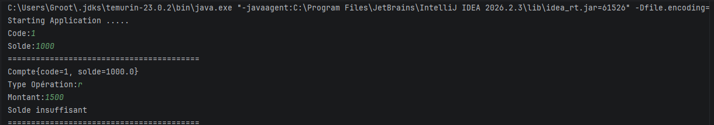

### `aspects.SecurityAspect` : authentification

Cet aspect ajoute une authentification avant le démarrage de l'application. Le pointcut `call(...)` intercepte l'appel à la méthode `start()`. Si le nom d'utilisateur et le mot de passe sont corrects, l'application démarre ; sinon l'accès est refusé.

```java
@Aspect
public class SecurityAspect {
    private String username = "root";
    private String password = "123";

    @Around("call(* test.Application.start(..))")
    public void secureApp(ProceedingJoinPoint proceedingJoinPoint) throws Throwable {
        Scanner scanner = new Scanner(System.in);
        System.out.println("Authentication");
        System.out.print("Username :");
        String user = scanner.next();
        System.out.print("Password :");
        String pass = scanner.next();
        if (user.equals(username) && pass.equals(password)) {
            System.out.println("Before starting");
            proceedingJoinPoint.proceed();
            System.out.println("End of Application");
        } else {
            System.out.println("Access denied ...");
        }
    }
}
```

Résultat :

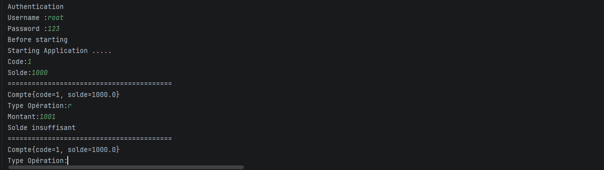

---

# 3. troisieme référence : Spring AOP
## 3.1 creation de projet
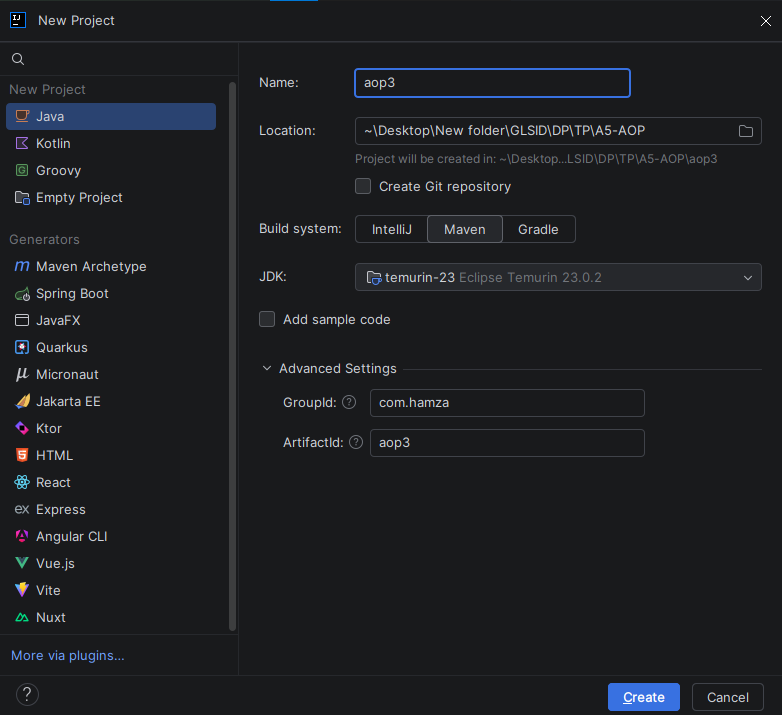
avec les dependances: 
```xml
<dependencies>
        <dependency>
            <groupId>org.springframework</groupId>
            <artifactId>spring-core</artifactId>
            <version>5.3.19</version>
        </dependency>
        <dependency>
            <groupId>org.springframework</groupId>
            <artifactId>spring-context</artifactId>
            <version>5.3.19</version>
        </dependency>
        <dependency>
            <groupId>org.springframework</groupId>
            <artifactId>spring-beans</artifactId>
            <version>5.3.19</version>
        </dependency>
        <dependency>
            <groupId>org.springframework</groupId>
            <artifactId>spring-aop</artifactId>
            <version>5.3.19</version>
        </dependency>
        <dependency>
            <groupId>org.springframework</groupId>
            <artifactId>spring-aspects</artifactId>
            <version>5.3.19</version>
        </dependency>
</dependencies>
```
## 3.2 creation de la couche metier :
on creer les class 
- `Imetier`
```java
public interface Imetier {
    public void process();
    double compute();
}
```
- `ImetierImpl`
```java
@Service
public class ImetierImpl implements Imetier {
    @Override
    public void process() {
        System.out.println("Business process ......");
    }

    @Override
    public double compute() {
        double data = 78;
        System.out.println("Business computing and return ......");
        return data;
    }
}
```
## 3.3 Creation de la class Application
```java
@ComponentScan(basePackages = {"ma.enset.service"})
public class Application {
    public static void main(String[] args) {
//        ApplicationContext applicationContext = new AnnotationConfigApplicationContext("ma.enset");
        ApplicationContext applicationContext = new AnnotationConfigApplicationContext(Application.class);
        Imetier metier = applicationContext.getBean(Imetier.class);
        System.out.println("************************************");
        System.out.println(metier.getClass().getName());
        System.out.println("************************************");
        metier.process();
        System.out.println(metier.compute());
    }
}
```

on le tester \

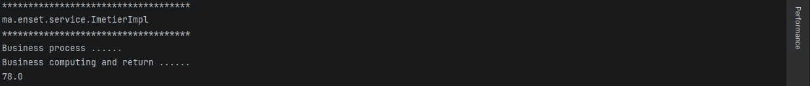

## 3.4 creation de LogAspect
```java
@Component
@Aspect
@EnableAspectJAutoProxy
public class LogAspect {
    @Before("execution(* ma.enset.service.*.*(..))")
    public void log() {
        System.out.println("From Logging Aspects ... Before");
    }
}
```
et on change `Application`
```java
@ComponentScan(value = {"ma.enset.service","ma.enset.aspects"})
```
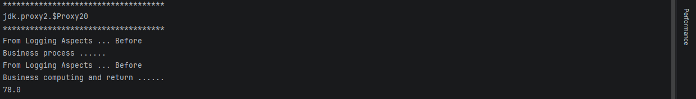 \
on change `before` par `around`
```java
@Component
@Aspect
@EnableAspectJAutoProxy
public class LogAspect {
//    @Before("execution(* ma.enset.service.*.*(..))")
    @Around("execution(* ma.enset.service.*.*(..))")
    public Object log(ProceedingJoinPoint proceedingJoinPoint) throws Throwable {
        long t1 = System.currentTimeMillis();
        System.out.println("From Logging Aspects ... Before " + proceedingJoinPoint.getSignature());
        Object result = proceedingJoinPoint.proceed();
        System.out.println("From Logging Aspects ... After " + proceedingJoinPoint.getSignature());
        System.out.println("Duration : " + (System.currentTimeMillis() - t1));
        return result;

    }
}
```
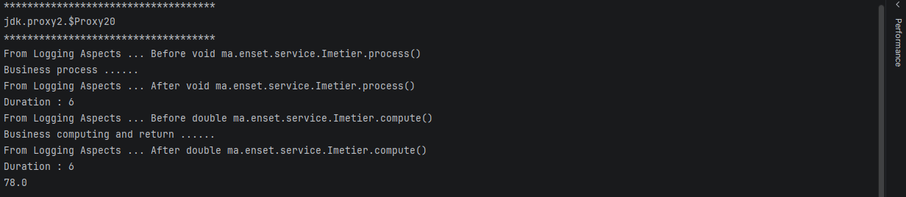 \

On utilisant `Logger`
```java
public class LogAspect {
    //    @Before("execution(* ma.enset.service.*.*(..))")
    Logger logger = Logger.getLogger(LogAspect.class.getName());
    @Around("execution(* ma.enset.service.*.*(..))")
    public Object log(ProceedingJoinPoint proceedingJoinPoint) throws Throwable {
        long t1 = System.currentTimeMillis();
        logger.info("From Logging Aspects ... Before " + proceedingJoinPoint.getSignature());
        Object result = proceedingJoinPoint.proceed();
        logger.info("From Logging Aspects ... After " + proceedingJoinPoint.getSignature());
        logger.info("Duration : " + (System.currentTimeMillis() - t1));
        return result;

    }
}
```
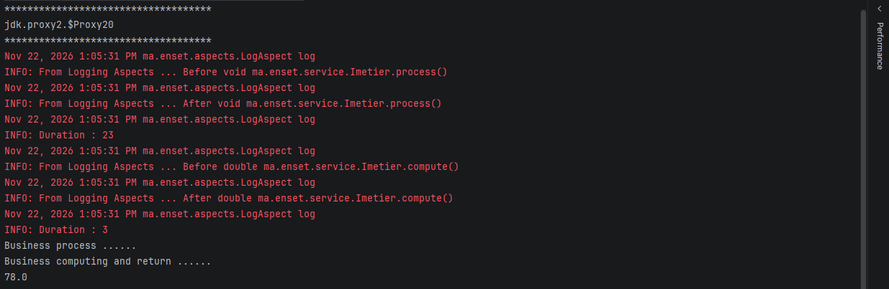 \

## 3.5 creation et utilisation des annotations
on ajoutons une annotation `@Log` dans la class `ImetierImpl`
```java
@Override
@Log
public void process() {
    System.out.println("Business process ......");
}

@Override
@Log
public double compute() {
    double data = 78;
    System.out.println("Business computing and return ......");
    return data;
}
```
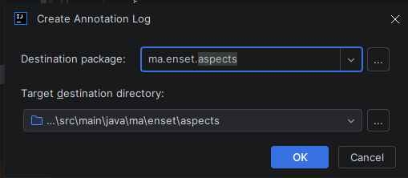 \
dans `LogAspect`
```java
@Around("@annotation(ma.enset.aspects.Log)")
```
et annotation de `Log`
```java
@Retention(RetentionPolicy.RUNTIME)
@Target(ElementType.METHOD)
public @interface Log {
}
```
`@Retention` : est ce que l'annotation s'execute au compilation ou l'execution.
`@Target` : est ce que l'annotation pour les class ou les methodes. \
 \

on creer l'annotation `SecuredByAspect` qui utilise les roles. \
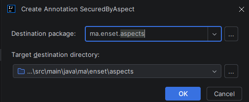 \
on joutons l'annotation dans `ImetierImpl`
```java
@Override
@Log
@SecuredByAspect(roles={"USER","ADMIN"})
public void process() {
    System.out.println("Business process ......");
}

@Override
@Log
@SecuredByAspect(roles={"ADMIN"})
public double compute() {
    double data = 78;
    System.out.println("Business computing and return ......");
    return data;
}
```
`SecuredByAspect`
```java
@Retention(RetentionPolicy.RUNTIME)
@Target(ElementType.METHOD)
public @interface SecuredByAspect {
    String[] roles();
}
```
on creer la class `service.SecurityContext`
```java
public class SecurityContext {
    private static String username="";
    private static String passowrd="";
    private static String[] roles={};
    public static void authenticate (String u, String p, String[] r){
        if(u.equals("root")&&p.equals("1234")){
            username=u;
            passowrd=p;
            roles=r;
        } else {
            throw new RuntimeException("Access denied");
        }
    }
    public static boolean hasRole(String r){
        for(String role : roles){
            if(role.equals(r)){
                return true;
            }
        }
        return false;
    }
}
```

et dans `Application`
```java
SecurityContext.authenticate("rot","1234", new String[]{"USER","ADMIN"});
ApplicationContext applicationContext = new AnnotationConfigApplicationContext(Application.class);
Imetier metier = applicationContext.getBean(Imetier.class);
...
```
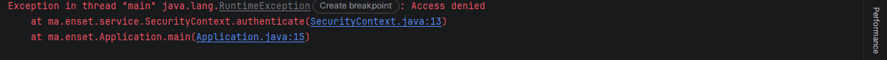 \
```java
SecurityContext.authenticate("root","1234", new String[]{"USER","ADMIN"});
...
```
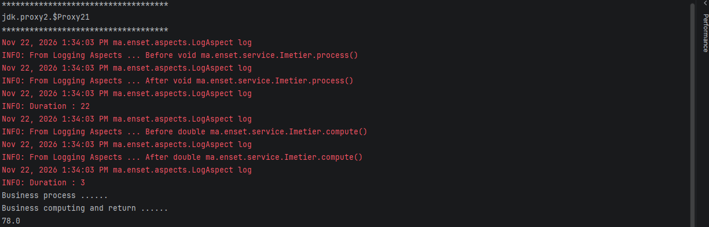 \

on creeer la class `AutorisationAspect`
```java
@Aspect
@Component
@EnableAspectJAutoProxy
public class AutorisationAspect {
    @Around(value = "@annotation(securedByAspect)", argNames = "pjp,securedByAspect")
    public Object secure(ProceedingJoinPoint pjp, SecuredByAspect securedByAspect) throws Throwable {
        String[] roles = securedByAspect.roles();
        boolean authrized = false;
        for(String r : roles){
            if(SecurityContext.hasRole(r)){
                authrized=true;
                break;
            }
        }
        if(authrized==true){
            Object result = pjp.proceed();
            return result;
        }
        throw new RuntimeException("Unauthorized => 403");

    }
}
```
on le tester 
```java
SecurityContext.authenticate("root","1234", new String[]{"USER","ADMIN"});
```
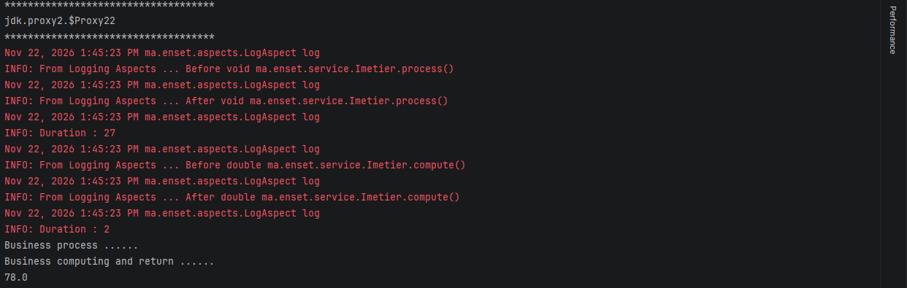 \
```java
SecurityContext.authenticate("root","1234", new String[]{"USER"});
```
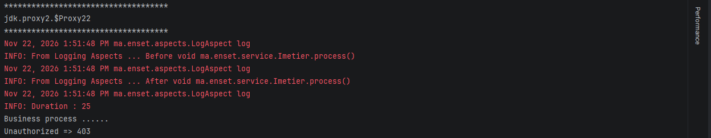 \
