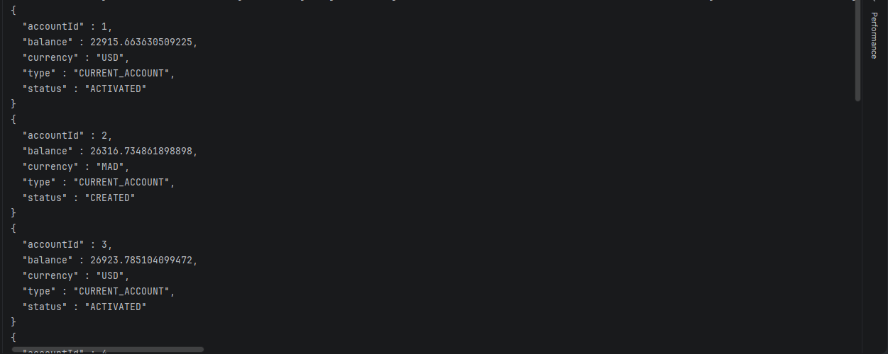
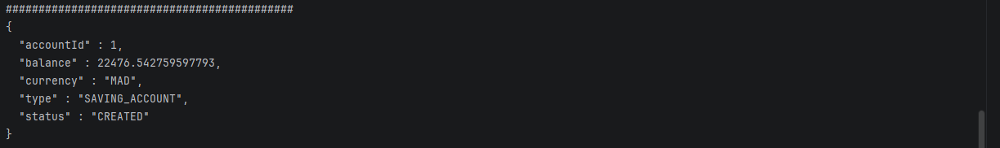
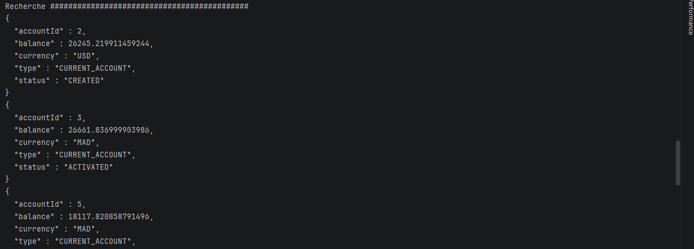
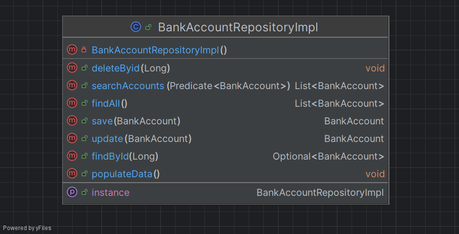
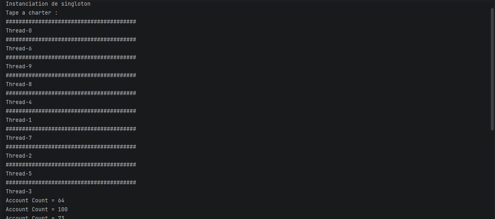
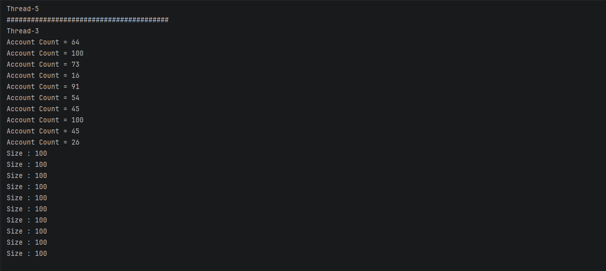
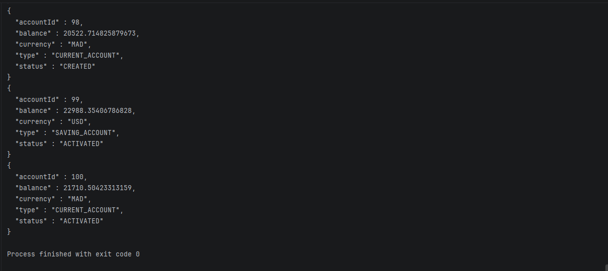
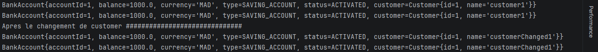
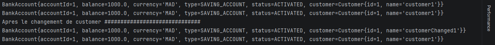
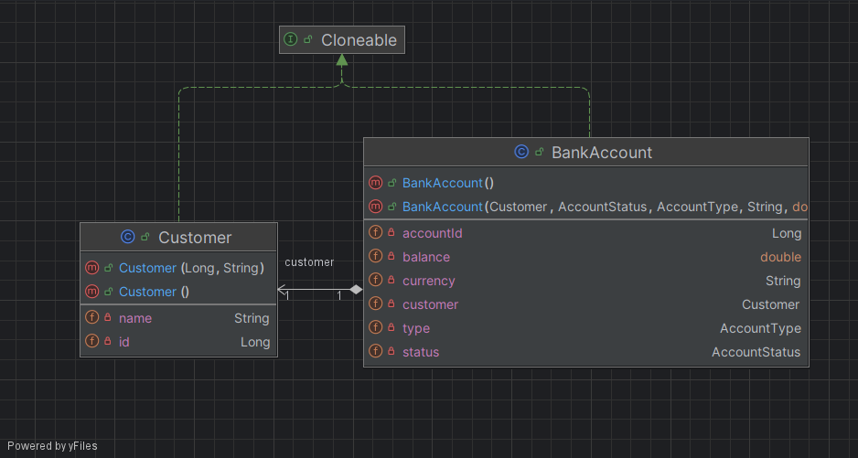

# Activité Pratique N°7 : Patterns de création (Singleton, Builder, Prototype)

**Nom et prénom :** Elcadi Hamza  
**Filière :** GLSID-3  
**Référence :** https://www.youtube.com/watch?v=c46mTB9o2qo

---

## Introduction

Cette activité présente trois patrons de conception (design patterns) de **création**, c'est-à-dire des patrons qui encadrent la façon dont les objets sont instanciés :

- **Builder** : construire un objet complexe étape par étape, de manière lisible.
- **Singleton** : garantir qu'une classe n'a qu'une seule instance dans toute l'application.
- **Prototype** : créer un nouvel objet en clonant un objet existant.

Nous les appliquons à un exemple de gestion de comptes bancaires.

---

## 1 - Pattern BUILDER

### 1.1 - Modèle et couche d'accès aux données

Nous créons la classe `model.BankAccount`, ainsi que les énumérations `AccountType` et `AccountStatus`. Nous générons ensuite les getters, les setters, les constructeurs et la méthode `toString`.

```java
public class BankAccount {
    private long accountId;
    private double balance;
    private String currency;
    private AccountType type;
    private AccountStatus status;
}
```

Nous créons l'interface `repository.BankAccountRepository`. La méthode `searchAccounts` prend un `Predicate` en paramètre : cela permet de rechercher selon n'importe quel critère, sans connaître à l'avance les paramètres de recherche.

```java
public interface BankAccountRepository {
    BankAccount save(BankAccount bankAccount);
    List<BankAccount> findAll();
    Optional<BankAccount> findById(Long id);
    List<BankAccount> searchAccounts(Predicate<BankAccount> predicate);
    BankAccount update(BankAccount bankAccount);
    void deleteById(Long id);
}
```

Puis son implémentation `repository.BankAccountRepositoryImpl`, qui stocke les comptes dans une `HashMap` :

```java
public class BankAccountRepositoryImpl implements BankAccountRepository {
    private Map<Long, BankAccount> bankAccountMap = new HashMap<>();
    private long accountsCount = 0;

    @Override
    public BankAccount save(BankAccount bankAccount) {
        Long accountId = ++accountsCount;
        bankAccount.setAccountId(accountId);
        bankAccountMap.put(accountId, bankAccount);
        return bankAccount;
    }

    @Override
    public List<BankAccount> findAll() {
        return bankAccountMap.values().stream().toList();
    }

    @Override
    public Optional<BankAccount> findById(Long id) {
        return Optional.ofNullable(bankAccountMap.get(id));
    }

    @Override
    public List<BankAccount> searchAccounts(Predicate<BankAccount> predicate) {
        return bankAccountMap.values().stream().filter(predicate).collect(Collectors.toList());
    }

    @Override
    public BankAccount update(BankAccount bankAccount) {
        bankAccountMap.put(bankAccount.getAccountId(), bankAccount);
        return bankAccount;
    }

    @Override
    public void deleteById(Long id) {
        bankAccountMap.remove(id);
    }
}
```

### 1.2 - Pourquoi utiliser un Builder ?

Nous ajoutons la méthode `populateData` pour remplir le dépôt avec des comptes de test :

```java
public void populateData() {
    for (int i = 0; i < 10; i++) {
        BankAccount bankAccount = new BankAccount();
    }
}
```

Il existe trois façons de remplir les attributs d'un objet `BankAccount` :
1. avec un **constructeur à paramètres** : le code devient difficile à lire dès qu'il y a beaucoup de paramètres, et l'ordre des arguments prête à confusion ;
2. avec des **setters** : le code est verbeux, et l'objet existe dans un état incomplet pendant sa construction ;
3. avec le **pattern Builder** : la construction est lisible, progressive et enchaînée.

### 1.3 - Implémentation du Builder

Nous créons une classe interne statique `AccountBuilder` dans `BankAccount`. Chaque méthode modifie un attribut de l'objet en cours de construction et retourne le builder lui-même (`this`), ce qui permet d'enchaîner les appels :

```java
public static class AccountBuilder {
    private BankAccount bankAccount = new BankAccount();

    public AccountBuilder accountId(Long id) {
        bankAccount.accountId = id;
        return this;
    }

    public AccountBuilder balance(double balance) {
        bankAccount.balance = balance;
        return this;
    }

    public AccountBuilder currency(String currency) {
        bankAccount.currency = currency;
        return this;
    }

    public AccountBuilder type(AccountType type) {
        bankAccount.type = type;
        return this;
    }

    public AccountBuilder status(AccountStatus status) {
        bankAccount.status = status;
        return this;
    }

    public BankAccount build() {
        return this.bankAccount;
    }
}
```

Pour l'utiliser, nous ajoutons dans `BankAccount` une méthode statique qui crée le builder :

```java
public static AccountBuilder builder() {
    return new AccountBuilder();
}
```

Puis nous le testons dans la classe `Main` :

```java
public class Main {
    public static void main(String[] args) {
        BankAccount bankAccount = BankAccount.builder()
                .accountId(1L)
                .currency("MAD")
                .status(AccountStatus.CREATED)
                .type(AccountType.SAVING_ACCOUNT)
                .balance(74000)
                .build();
        System.out.println(bankAccount);
    }
}
```

Résultat :


### 1.4 - Personnalisation du Builder

Le builder permet aussi d'appliquer des règles métier pendant la construction. Dans l'exemple suivant, le statut demandé n'est pris en compte que pour un compte courant ; sinon le compte est automatiquement activé :

```java
public AccountBuilder status(AccountStatus status) {
    if (bankAccount.getType().equals(AccountType.CURRENT_ACCOUNT)) {
        bankAccount.status = status;
    } else {
        bankAccount.status = AccountStatus.ACTIVATED;
    }
    return this;
}
```

> **Attention :** cette méthode lit `bankAccount.getType()`. Il faut donc appeler `type(...)` **avant** `status(...)`, sinon on obtient une `NullPointerException`.

Diagramme de classes :


### 1.5 - La classe Director

Nous créons la classe `main.Director`. Son rôle est de centraliser la construction : elle peut proposer plusieurs builders préconfigurés.

```java
public class Director {
    public static BankAccount.AccountBuilder accountBuilder() {
        return new BankAccount.AccountBuilder();
    }
}
```

Nous supprimons la méthode `builder()` de `BankAccount`, puis nous testons :

```java
BankAccount bankAccount = Director.accountBuilder()
        .accountId(1L)
        .currency("MAD")
        .status(AccountStatus.CREATED)
        .type(AccountType.SAVING_ACCOUNT)
        .balance(75000)
        .build();
System.out.println(bankAccount);
```

Résultat :


Les différents builders sont ainsi regroupés dans la classe `Director` :


Comme elle servira à construire d'autres objets, nous renommons `Director` en `BankDirector`.

### 1.6 - Génération de données de test

Nous modifions `populateData` dans `BankAccountRepositoryImpl` pour générer 10 comptes aléatoires :

```java
public void populateData() {
    for (int i = 0; i < 10; i++) {
        BankAccount bankAccount = BankDirector.accountBuilder()
                .balance(18000 + Math.random() * 9000)
                .type(Math.random() > 0.5 ? AccountType.SAVING_ACCOUNT : AccountType.CURRENT_ACCOUNT)
                .currency(Math.random() > 0.5 ? "MAD" : "USD")
                .build();
        save(bankAccount);
    }
}
```

Test :

```java
BankAccountRepositoryImpl repository = new BankAccountRepositoryImpl();
repository.populateData();
List<BankAccount> bankAccounts = repository.findAll();
bankAccounts.forEach(System.out::println);
```

Résultat :


### 1.7 - Affichage au format JSON

Pour obtenir un affichage plus lisible, nous ajoutons la dépendance Jackson :

```xml
<dependencies>
    <dependency>
        <groupId>com.fasterxml.jackson.core</groupId>
        <artifactId>jackson-databind</artifactId>
        <version>2.14.1</version>
    </dependency>
</dependencies>
```

et nous créons la classe générique `util.JsonSerializer`, qui convertit n'importe quel objet en JSON (Jackson s'appuie sur les getters de la classe) :

```java
public class JsonSerializer<T> {
    public String toJson(T dataObject) {
        ObjectMapper objectMapper = new ObjectMapper();
        try {
            return objectMapper.writerWithDefaultPrettyPrinter().writeValueAsString(dataObject);
        } catch (JsonProcessingException e) {
            throw new RuntimeException(e);
        }
    }
}
```

Utilisation dans le `main` :

```java
JsonSerializer<BankAccount> bankAccountJsonSerializer = new JsonSerializer<>();
BankAccountRepositoryImpl repository = new BankAccountRepositoryImpl();
repository.populateData();
List<BankAccount> bankAccounts = repository.findAll();
bankAccounts.stream()
        .map(acc -> bankAccountJsonSerializer.toJson(acc))
        .forEach(System.out::println);
```

Résultat :



### 1.8 - Test de `findById` et de la recherche

Test de `findById` :

```java
System.out.println("############################################");
BankAccount account = repository.findById(1L).orElse(null);
if (account != null) {
    System.out.println(bankAccountJsonSerializer.toJson(account));
}
```

Résultat :



Test de la recherche avec un `Predicate` (ici, tous les comptes courants) :

```java
System.out.println("Recherche ############################################");
List<BankAccount> bankAccounts2 = repository.searchAccounts(new Predicate<BankAccount>() {
    @Override
    public boolean test(BankAccount bankAccount) {
        return bankAccount.getType().equals(AccountType.CURRENT_ACCOUNT);
    }
});
bankAccounts2.stream()
        .map(acc -> bankAccountJsonSerializer.toJson(acc))
        .forEach(System.out::println);
```

Résultat :



---

## 2 - Pattern SINGLETON

Le pattern Singleton garantit qu'une classe n'a **qu'une seule instance**, accessible globalement. Il est utile pour les ressources partagées (dépôt de données, configuration, connexion, etc.).

Pour l'appliquer à `BankAccountRepositoryImpl`, il faut :
1. rendre le **constructeur privé**, pour empêcher l'instanciation depuis l'extérieur ;
2. créer l'instance unique dans un attribut **statique** ;
3. fournir une méthode statique `getInstance()` pour y accéder.

```java
private static final BankAccountRepositoryImpl accountRepository;

static {
    System.out.println("Instanciation du singleton");
    accountRepository = new BankAccountRepositoryImpl();
}

// Constructeur privé : la classe ne peut être instanciée qu'à l'intérieur d'elle-même
private BankAccountRepositoryImpl() {
}

// Méthode d'accès à l'instance unique
public static BankAccountRepositoryImpl getInstance() {
    return accountRepository;
}
```

Ici, l'instance est créée dès le chargement de la classe (**initialisation anticipée**, ou *eager*). Une variante consiste à la créer seulement au premier appel (**initialisation paresseuse**, ou *lazy*) :

```java
private static BankAccountRepositoryImpl accountRepository;

public static BankAccountRepositoryImpl getInstance() {
    if (accountRepository == null) {
        accountRepository = new BankAccountRepositoryImpl();
    }
    return accountRepository;
}
```

> La version *lazy* n'est pas sûre en multithreading : deux threads peuvent créer deux instances. La version *eager* ci-dessus n'a pas ce problème, car la JVM garantit que l'initialisation statique n'a lieu qu'une seule fois.

Test dans le `Main` :

```java
// Au lieu de :
BankAccountRepositoryImpl repository = new BankAccountRepositoryImpl();

// On écrit :
BankAccountRepositoryImpl repository = BankAccountRepositoryImpl.getInstance();

// Même en appelant getInstance() plusieurs fois :
BankAccountRepositoryImpl repository1 = BankAccountRepositoryImpl.getInstance();
BankAccountRepositoryImpl repository2 = BankAccountRepositoryImpl.getInstance();
BankAccountRepositoryImpl repository3 = BankAccountRepositoryImpl.getInstance();
// c'est toujours le même objet : le singleton garantit une seule instance en mémoire.
```



### 2.1 - Le problème du multithreading

Même avec un singleton, l'instance unique est **partagée** entre tous les threads, ce qui pose des problèmes d'accès concurrents. Pour le montrer, nous ajoutons des affichages à la fin de `populateData` :

```java
public void populateData() {
    for (int i = 0; i < 10; i++) {
        BankAccount bankAccount = BankDirector.accountBuilder()
                .balance(18000 + Math.random() * 9000)
                .type(Math.random() > 0.5 ? AccountType.SAVING_ACCOUNT : AccountType.CURRENT_ACCOUNT)
                .status(Math.random() > 0.5 ? AccountStatus.CREATED : AccountStatus.ACTIVATED)
                .currency(Math.random() > 0.5 ? "MAD" : "USD")
                .build();
        save(bankAccount);
    }
    System.out.println("########################################");
    System.out.println(Thread.currentThread().getName());
    System.out.println("Account Count = " + accountsCount);
    System.out.println("Size : " + bankAccountMap.values().size());
}
```

Dans le `Main`, nous lançons 10 threads qui appellent `populateData` en même temps :

```java
JsonSerializer<BankAccount> bankAccountJsonSerializer = new JsonSerializer<>();
BankAccountRepositoryImpl repository = BankAccountRepositoryImpl.getInstance();
for (int i = 0; i < 10; i++) {
    new Thread(() -> {
        repository.populateData();
    }).start();
}
List<BankAccount> bankAccounts = repository.findAll();
bankAccounts.stream()
        .map(acc -> bankAccountJsonSerializer.toJson(acc))
        .forEach(System.out::println);
```

Résultats :





On constate que les valeurs de `accountsCount` et la taille de la map ne sont pas cohérentes. Cela s'explique par une **situation de compétition** (*race condition*) : l'opération `++accountsCount` n'est pas atomique, donc deux threads peuvent obtenir le même identifiant et s'écraser mutuellement dans la map.

Pour corriger le problème, on peut synchroniser l'incrémentation du compteur :

```java
// Avant
public BankAccount save(BankAccount bankAccount) {
    Long accountId = ++accountsCount;
    bankAccount.setAccountId(accountId);
    bankAccountMap.put(accountId, bankAccount);
    return bankAccount;
}

// Après
public BankAccount save(BankAccount bankAccount) {
    Long accountId;
    synchronized (this) {
        accountId = ++accountsCount;
    }
    bankAccount.setAccountId(accountId);
    bankAccountMap.put(accountId, bankAccount);
    return bankAccount;
}
```

> **Remarque :** ce correctif ne règle qu'une partie du problème. `HashMap` n'est pas non plus thread-safe, et dans le `Main` la lecture `findAll()` a lieu sans attendre la fin des threads (il faudrait utiliser `join()`). Une solution plus robuste consiste à utiliser un `AtomicLong` pour le compteur et une `ConcurrentHashMap` pour le stockage :
> ```java
> private Map<Long, BankAccount> bankAccountMap = new ConcurrentHashMap<>();
> private AtomicLong accountsCount = new AtomicLong();
> ```

---

## 3 - Pattern PROTOTYPE

Le pattern Prototype consiste à **cloner un objet existant** (créer une instance identique) au lieu de le recréer de zéro.

### 3.1 - Copie manuelle

Première approche : copier chaque attribut à la main.

```java
public static void main(String[] args) {
    BankAccount bankAccount1 = new BankAccount();
    bankAccount1.setAccountId(1L);
    bankAccount1.setBalance(1000);
    bankAccount1.setCurrency("MAD");
    bankAccount1.setStatus(AccountStatus.ACTIVATED);
    bankAccount1.setType(AccountType.SAVING_ACCOUNT);

    BankAccount bankAccount2 = new BankAccount();
    bankAccount2.setAccountId(bankAccount1.getAccountId());
    bankAccount2.setBalance(bankAccount1.getBalance());
    bankAccount2.setCurrency(bankAccount1.getCurrency());
    bankAccount2.setStatus(bankAccount1.getStatus());
    bankAccount2.setType(bankAccount1.getType());
}
```

Cette méthode est longue et fragile : si on ajoute un attribut à la classe, il faut penser à mettre à jour toutes les copies.

### 3.2 - Utilisation du pattern Prototype

En Java, le pattern repose sur l'interface `Cloneable` et la méthode `clone()`. Dans `BankAccount` :

```java
public class BankAccount implements Cloneable {
    // ...
    @Override
    public BankAccount clone() throws CloneNotSupportedException {
        return (BankAccount) super.clone();
    }
}
```

Dans le `main` :

```java
public static void main(String[] args) throws CloneNotSupportedException {
    BankAccount bankAccount1 = new BankAccount();
    bankAccount1.setAccountId(1L);
    bankAccount1.setBalance(1000);
    bankAccount1.setCurrency("MAD");
    bankAccount1.setStatus(AccountStatus.ACTIVATED);
    bankAccount1.setType(AccountType.SAVING_ACCOUNT);

    BankAccount bankAccount2 = bankAccount1.clone(); // nouvel objet : adresse différente
    BankAccount bankAccount3 = bankAccount1;         // même objet : même adresse

    // (en supprimant au préalable la méthode toString pour voir les adresses)
    System.out.println(bankAccount1); // @387f28282
    System.out.println(bankAccount2); // @1d8112233
    System.out.println(bankAccount3); // @387f28282
}
```

On voit que `bankAccount2` est un nouvel objet, alors que `bankAccount3` est seulement une deuxième référence vers le même objet que `bankAccount1`.

Le pattern Prototype consiste donc à définir un moyen de cloner un objet. En Java, il suffit d'utiliser la méthode `clone()`, qui évite de recopier manuellement chaque attribut.

### 3.3 - Cas d'un objet composé

La méthode `clone()` par défaut effectue une **copie superficielle** (*shallow copy*) : les attributs de type objet ne sont pas dupliqués, seule leur référence est copiée. Pour le montrer, nous ajoutons l'attribut `customer` dans `BankAccount` :

```java
private Customer customer;
```

et nous créons la classe `Customer` (avec constructeurs, getters et setters) :

```java
public class Customer {
    private Long id;
    private String name;

    public Customer() {
    }

    public Customer(Long id, String name) {
        this.id = id;
        this.name = name;
    }

    public Long getId() {
        return id;
    }

    public void setId(Long id) {
        this.id = id;
    }

    public String getName() {
        return name;
    }

    public void setName(String name) {
        this.name = name;
    }

    @Override
    public String toString() {
        return "Customer{" +
                "id=" + id +
                ", name='" + name + '\'' +
                '}';
    }
}
```

Dans le `main`, nous clonons le compte, puis nous modifions le nom du client du compte d'origine :

```java
BankAccount bankAccount1 = new BankAccount();
bankAccount1.setAccountId(1L);
bankAccount1.setBalance(1000);
bankAccount1.setCurrency("MAD");
bankAccount1.setStatus(AccountStatus.ACTIVATED);
bankAccount1.setType(AccountType.SAVING_ACCOUNT);
bankAccount1.setCustomer(new Customer(1L, "customer1"));

BankAccount bankAccount2 = bankAccount1.clone();
System.out.println(bankAccount1);
System.out.println(bankAccount2);

bankAccount1.getCustomer().setName("customerChanged1");
System.out.println("Après le changement de customer ##############################");
System.out.println(bankAccount1);
System.out.println(bankAccount2);
```

Résultat :



Le nom du client a changé **dans les deux comptes**, car le clone et l'original partagent le même objet `Customer`.

### 3.4 - Copie profonde (deep copy)

Pour que le clone ait son propre `Customer`, il faut aussi cloner l'objet composé dans la méthode `clone()` de `BankAccount` :

```java
@Override
public BankAccount clone() throws CloneNotSupportedException {
    BankAccount bankAccount = (BankAccount) super.clone();
    bankAccount.setCustomer(this.customer.clone());
    return bankAccount;
}
```

La classe `Customer` doit alors implémenter `Cloneable` et redéfinir `clone()` :

```java
public class Customer implements Cloneable {
    // ...
    @Override
    public Customer clone() throws CloneNotSupportedException {
        return (Customer) super.clone();
    }
}
```

Résultat : la modification du client de `bankAccount1` n'affecte plus `bankAccount2`.



Diagramme de classes :


