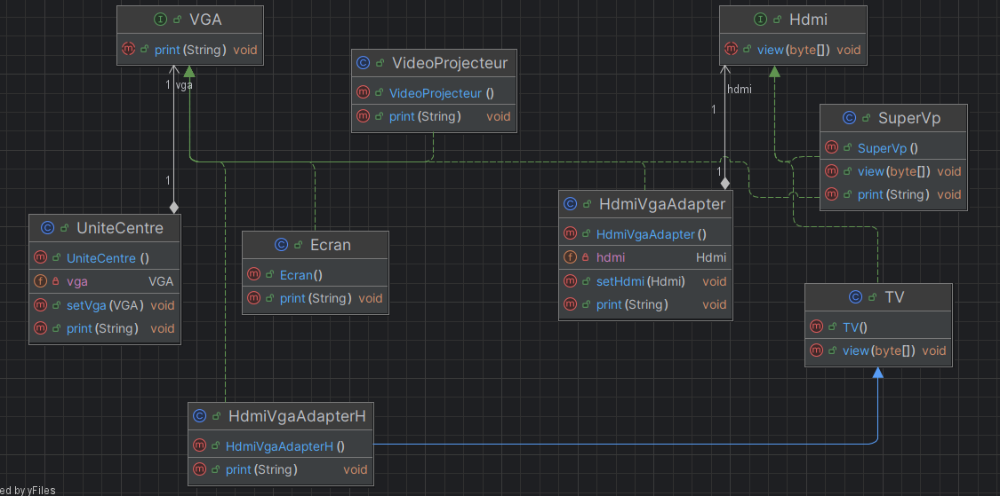
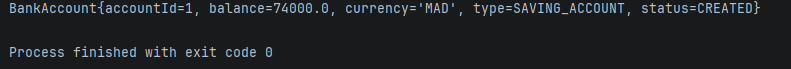
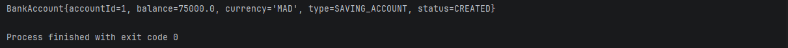
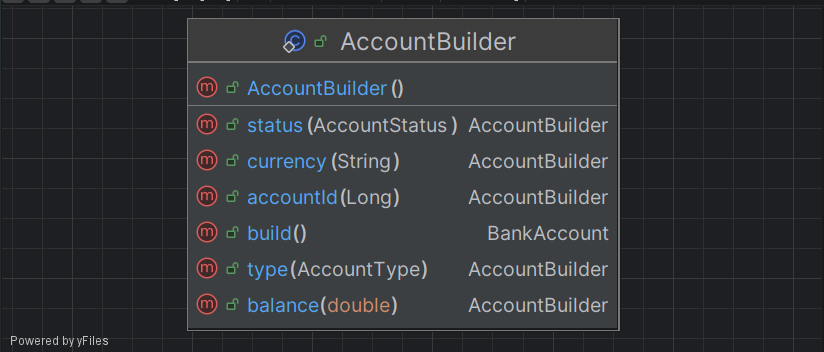
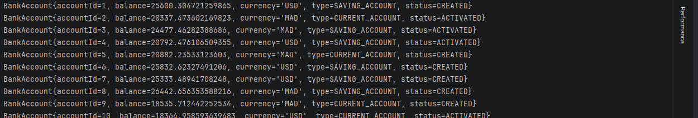

# Activité Pratique N°7- Patterns Création : Singleton, Builder, Prototype

Nom et prénom : Elcadi Hamza  
Filière : GLSID-3  
Référence : https://www.youtube.com/watch?v=c46mTB9o2qo

---

## 1 - Diagramme du pattern Adapter

On a commencé par créer les classes nécessaires pour implémenter le pattern Adapter.



---

## Implémentation du diagramme de classes
On crée la classe `model.BankAccount` :
```java
public class BankAccount {
    private long accountId;
    private double balance;
    private String currency;
    private AccountType type;
    private AccountStatus status;
    
}
```
et ces enums, et on generate getters et setters et les constructeurs et `toString`.
- interface `repository.AccountRepository`
```java
public interface BankAccountRepository {
    BankAccount save(BankAccount bankAccount);
    List<BankAccount> findAll();
    Optional<BankAccount> findById(Long id);
    List<BankAccount> searchAccounts(Predicate<BankAccount> predicate); // if we don know what parameter
    BankAccount update(BankAccount bankAccount);
    void deleteByid(Long id);
}
```
- 'repository.AccountRepositoryImpl'
```java
public class BankAccountRepositoryImpl implements BankAccountRepository {
    private Map<Long, BankAccount> bankAccountMap = new HashMap<>();
    private long accountsCount=0;
    @Override
    public BankAccount save(BankAccount bankAccount) {
        Long accountId = ++accountsCount;
        bankAccount.setAccountId(accountId);
        bankAccountMap.put(accountId, bankAccount);
        return bankAccount;
    }

    @Override
    public List<BankAccount> findAll() {
        return bankAccountMap.values().stream().toList();
    }

    @Override
    public Optional<BankAccount> findById(Long id) {
        BankAccount account = bankAccountMap.get(id);
        if(account == null){
            return Optional.empty();
        }
        else {
            return Optional.of(account);
        }
    }

    @Override
    public List<BankAccount> searchAccounts(Predicate<BankAccount> predicate) {

        return bankAccountMap.values().stream().filter(predicate).collect(Collectors.toList());
    }

    @Override
    public BankAccount update(BankAccount bankAccount) {
        bankAccountMap.put(bankAccount.getAccountId(), bankAccount);
        return bankAccount;
    }

    @Override
    public void deleteByid(Long id) {
        bankAccountMap.remove(id);

    }
   
}
```
on ajoutons la methode `populateData`
```java

public void populateData() {
    for(int i = 0 ; i < 10 ; i++){
        BankAccount bankAccount = new BankAccount();
    }
}
```
il ya trois facons de remplir `bankAccount`
- 1 . constructeur avec parametre
- 2 . setters
- 3 . on utilisant le pattern builder
- on creer une class intern dans `BankAccount`
```java
public static class AccountBuilder {
    private BankAccount bankAccount = new BankAccount();

    public AccountBuilder accountId(Long id){
        bankAccount.accountId = id;
        return this;
    }
    public AccountBuilder balance(double balance){
        bankAccount.balance = balance;
        return this;
    }
    public AccountBuilder currency(String currency){
        bankAccount.currency = currency;
        return this;
    }
    public AccountBuilder type(AccountType type){
        bankAccount.type = type;
        return this;
    }
    public AccountBuilder status(AccountStatus status){
        bankAccount.status = status;
        return this;
    }
    public BankAccount build() {
        return this.bankAccount;
    }
}
```
pour utiliser, dans la class `BankAccount`
```java
public static AccountBuilder builder() {
    return new AccountBuilder();
}
```
puis dans `BankAccountRepositoryImpl`
```java
public class Main {
    public static void main(String[] args){
        BankAccount bankAccount = BankAccount.builder()
                .accountId(1L)
                .currency("MAD")
                .status(AccountStatus.CREATED)
                .type(AccountType.SAVING_ACCOUNT)
                .balance(74000)
                .build();
        System.out.println(bankAccount);
    }
}
```
 \
on peut cositimiser le builder
```java
public AccountBuilder status(AccountStatus status){
    if(bankAccount.getType().equals(AccountType.CURRENT_ACCOUNT)){
        bankAccount.status = status;
    }
    else bankAccount.status=AccountStatus.ACTIVATED;
    return this;
}
```
class diagramme : \

on creer la class `main.Director`, dans director on peut construire plusieur builder

```java
public class Director {
    public static BankAccount.AccountBuilder accountBuilder() {
        return new BankAccount.AccountBuilder();
    }
}
```
et on suprimmer la dans `BankAccount` et on le teste 
```java
BankAccount bankAccount = Director.accountBuilder()
        .accountId(1L)
        .currency("MAD")
        .status(AccountStatus.CREATED)
        .type(AccountType.SAVING_ACCOUNT)
        .balance(75000)
        .build();
System.out.println(bankAccount);
```
 \

On creer les builders dans les lcass director \

 \

on changer `Director` to `BankDirector` car on va construire d'autre builders \ 
dans `BankAccountRepositoryImpl`
```java
public void populateData() {
    for(int i = 0 ; i < 10 ; i++){
        BankAccount bankAccount = BankDirector.accountBuilder()
                .balance(18000+Math.random()*9000)
                .type(Math.random()>0.5? AccountType.SAVING_ACCOUNT : AccountType.CURRENT_ACCOUNT)
                .currency(Math.random()>0.5?"MAD":"USD")
                .build();
        save(bankAccount);
    }
}
```
on le tester
```java
BankAccountRepositoryImpl repository = new BankAccountRepositoryImpl();
repository.populateData();
List<BankAccount> bankAccounts = repository.findAll();
bankAccounts.forEach(System.out::println);
```
 \


on ajoutons la dependance :
```xml
<dependencies>
    <dependency>
        <groupId>com.fasterxml.jackson.core</groupId>
        <artifactId>jackson-databind</artifactId>
        <version>2.14.1</version>
    </dependency>
</dependencies>
```
et on creer la class `Util`

```java

```
