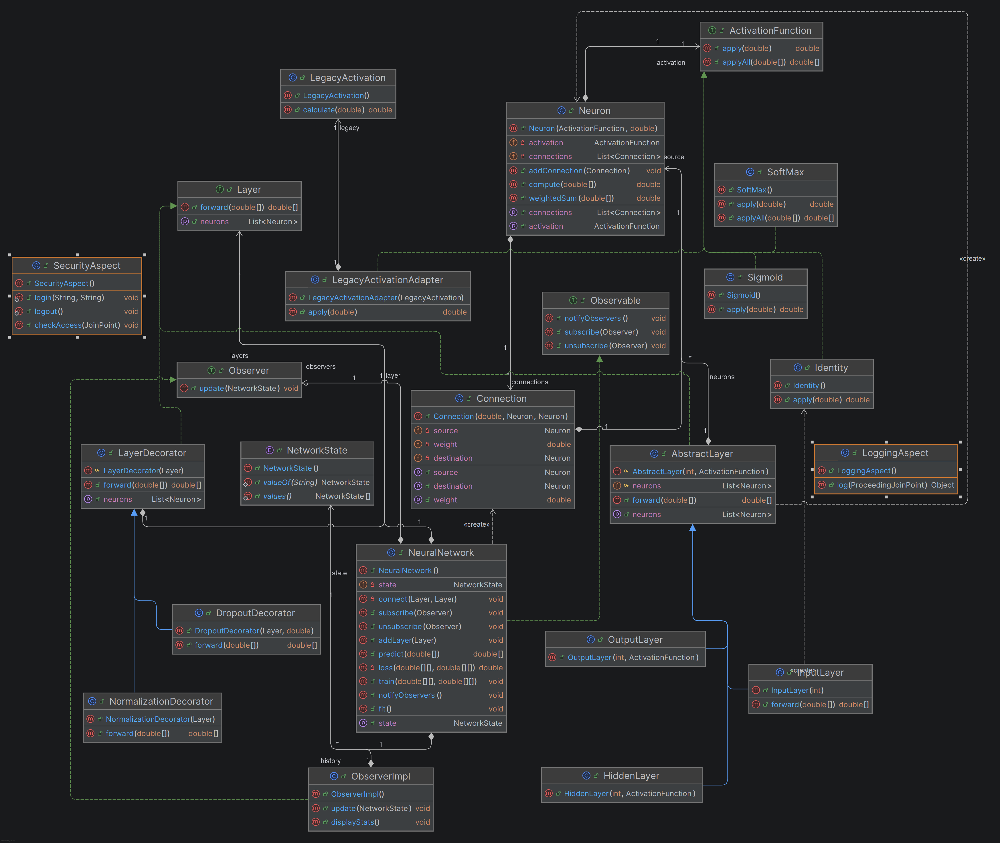
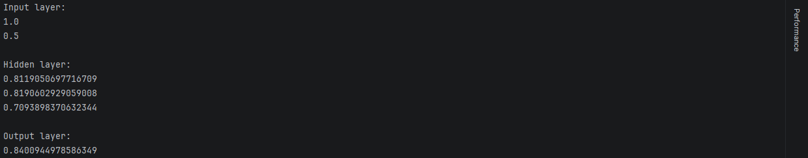
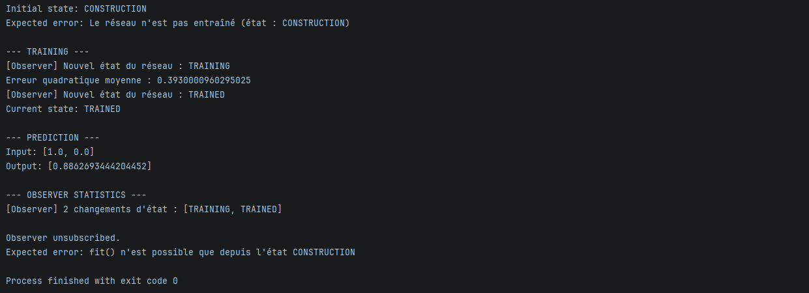
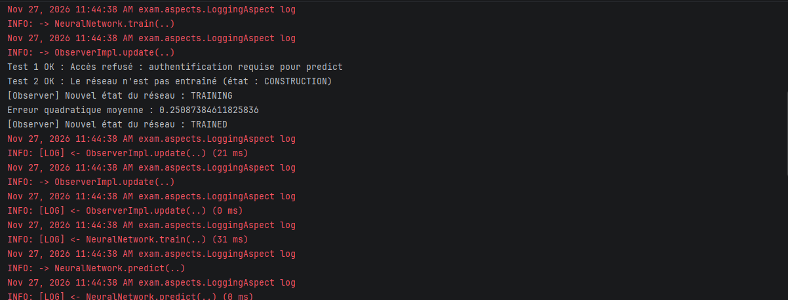
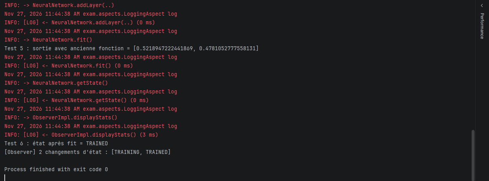

# Examen Design Pattern : Réseau de neurones artificiels

Modélisation et implémentation en Java d'un réseau de neurones artificiels (filière GLSID, ENSET Mohammedia), avec les design patterns Strategy, Adapter, Observer, Decorator et la programmation orientée aspect (Spring AOP).

**Par :** Hamza Elcadi

## Sujet

Un réseau de neurones se compose de couches (entrée, cachées, sortie). Chaque couche contient des neurones reliés par des connexions pondérées (poids entre 0 et 1). Chaque neurone calcule `S = ∑ Xi·Wi + b`, puis transmet `S` à sa fonction d'activation.

## Référence

- [Sujet de l'examen (PDF)](./A7-Examen.pdf)
## Diagramme de classes



## Design patterns utilisés

| Cond. | Pattern | Classes | Rôle |
|---|---|---|---|
| a | **Strategy** | `ActivationFunction`, `Sigmoid`, `Identity`, `SoftMax` | Fonctions d'activation encapsulées et interchangeables (`Neuron.setActivation()`) |
| b | **Adapter** | `LegacyActivation`, `LegacyActivationAdapter` | Adapte l'ancienne fonction (`calculate`) à l'interface `ActivationFunction` |
| c | *(énumération)* | `NetworkState` | États `CONSTRUCTION`, `TRAINING`, `TRAINED` |
| d | **Observer** | `Observable`, `Observer`, `ObserverImpl` | Notifie les abonnés à chaque changement d'état du réseau |
| e | **Decorator** | `LayerDecorator`, `DropoutDecorator`, `NormalizationDecorator` | Ajoute dynamiquement des fonctionnalités à une couche |
| f | **AOP** | `LoggingAspect` | Journalise l'entrée, la sortie, la durée et les erreurs des méthodes |
| g | **AOP** | `SecurityAspect` | Vérifie l'authentification avant `train`, `fit` et `predict` |

## Structure du projet

```
src/main/java/
├── Main.java
└── exam/
    ├── NeuralNetwork.java
    ├── Neuron.java
    ├── Connection.java
    ├── NetworkState.java
    ├── activation/
    │   ├── ActivationFunction.java
    │   ├── Sigmoid.java
    │   ├── Identity.java
    │   ├── SoftMax.java
    │   ├── LegacyActivation.java
    │   └── LegacyActivationAdapter.java
    ├── layer/
    │   ├── Layer.java
    │   ├── AbstractLayer.java
    │   ├── InputLayer.java
    │   ├── HiddenLayer.java
    │   ├── OutputLayer.java
    │   ├── LayerDecorator.java
    │   ├── DropoutDecorator.java
    │   └── NormalizationDecorator.java
    ├── observer/
    │   ├── Observable.java
    │   ├── Observer.java
    │   └── ObserverImpl.java
    └── aspects/
        ├── LoggingAspect.java
        └── SecurityAspect.java
```

## Fonctionnement

### États du réseau

```
CONSTRUCTION --train()--> TRAINING --(fin de l'entraînement)--> TRAINED
CONSTRUCTION ------------------fit()----------------------------> TRAINED
```

- Le réseau démarre à l'état `CONSTRUCTION`. Les couches ne peuvent être ajoutées que dans cet état.
- `predict()` n'est possible qu'à l'état `TRAINED`, sinon une `IllegalStateException` est levée.
- Chaque changement d'état notifie les observateurs.
- L'énoncé ne définit pas d'algorithme d'apprentissage : `train()` gère les états et calcule l'erreur quadratique moyenne, sans rétropropagation.

### Détails d'implémentation

- **SoftMax** s'applique sur tout le vecteur de sortie. `ActivationFunction` a donc une méthode par défaut `applyAll(double[])`, que `SoftMax` redéfinit.
- **Sigmoïde :** `f(x) = 1 / (1 + e^(-x))`.
- **Decorator :** les décorateurs s'empilent, par exemple `new NormalizationDecorator(new HiddenLayer(5, new Sigmoid()))`.
- **Spring AOP :** seuls les appels faits sur les beans Spring (`NeuralNetwork`, `ObserverImpl`) sont interceptés par les aspects. Les appels internes d'un objet à lui-même ne le sont pas.

## Prérequis

- Java (le `pom.xml` cible Java 23)
- Maven
- Dépendances Spring 5.3.19 : `spring-core`, `spring-context`, `spring-beans`, `spring-aop`, `spring-aspects`

## Exécution

```bash
mvn clean compile
mvn exec:java -Dexec.mainClass="Main"
```

Ou lancer directement la classe `Main` depuis l'IDE.

## Tests et résultats

### 1. Propagation des données couche par couche

Réseau avec 2 neurones en entrée, 3 neurones cachés (sigmoïde) et 1 neurone de sortie.



### 2. États du réseau, Observer et erreurs attendues

- `predict()` avant l'entraînement lève l'erreur attendue.
- `train()` fait passer le réseau par `TRAINING` puis `TRAINED`, et l'observateur est notifié.
- Après `unsubscribe()`, l'observateur n'est plus notifié.
- `fit()` depuis l'état `TRAINED` lève l'erreur attendue.



### 3. Sécurité et journalisation (AOP)

- **Test 1 :** `predict()` sans authentification est refusé par `SecurityAspect`.
- **Test 2 :** après authentification, `predict()` avant l'entraînement est refusé (état `CONSTRUCTION`).
- **Test 3 :** `train()` passe de `CONSTRUCTION` à `TRAINING` puis `TRAINED`.
- `LoggingAspect` trace chaque appel (`->` et `<-`) avec sa durée.



### 4. Strategy, Adapter et `fit()`

- **Test 5 :** la fonction d'activation de la couche cachée est remplacée à l'exécution par l'ancienne fonction via `LegacyActivationAdapter`.
- **Test 6 :** `fit()` fait passer un nouveau réseau directement de `CONSTRUCTION` à `TRAINED`.



## Amélioration : pattern Builder
`NeuralNetworkBuilder` assemble le réseau étape par étape, puis `build()` crée le réseau et connecte les couches entre elles.

```java
NeuralNetwork nn = new NeuralNetworkBuilder()
        .inputLayer(3)
        .hiddenLayer(5, new Sigmoid())
        .outputLayer(2, new SoftMax())
        .build();
```

`hiddenLayer(Layer)` accepte aussi une couche déjà créée, par exemple une couche décorée (Decorator) :

```java
HiddenLayer hidden = new HiddenLayer(5, new Sigmoid());
NeuralNetwork nn = new NeuralNetworkBuilder()
        .inputLayer(3)
        .hiddenLayer(new NormalizationDecorator(hidden))
        .outputLayer(2, new SoftMax())
        .build();
```
